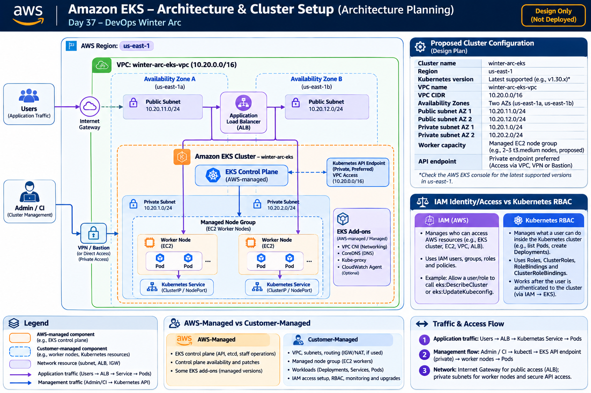

# Day 37 – AWS EKS: Architecture & Cluster Setup

## 1. Overview

**Day:** 37/90  
**Topic:** AWS EKS – Architecture & Cluster Setup  
**Platform:** Amazon Web Services (AWS), Ubuntu WSL, AWS CLI, kubectl  
**Region:** Asia Pacific (Mumbai) – `ap-south-1`

### Objective

The objective of Day 37 is to understand Amazon Elastic Kubernetes Service (EKS), plan a secure AWS network architecture, identify the IAM roles required for EKS, and understand how to create an EKS cluster with EC2 worker nodes.

This lab focuses on:

- Understanding EKS architecture and core components.
- Understanding the relationship between the EKS control plane and worker nodes.
- Planning a VPC with public and private subnets across two Availability Zones.
- Understanding IAM roles and Kubernetes RBAC.
- Performing AWS CLI pre-flight checks.
- Preparing an EKS cluster setup plan.
- Understanding cluster and managed node group creation.
- Learning common EKS troubleshooting commands.

**Cost note:** EKS cluster creation is optional and requires account-owner approval. EKS control plane, EC2 instances, NAT Gateways, load balancers, public IPv4 addresses, storage and data transfer may incur charges. An AWS Free Tier account does not guarantee that these resources are free.

---

## 2. Core Concepts

### 2.1 Amazon EKS

Amazon Elastic Kubernetes Service (EKS) is a managed Kubernetes service provided by AWS.

It allows us to run Kubernetes applications on AWS without manually installing and maintaining the Kubernetes control plane.

AWS manages the Kubernetes control plane, while we remain responsible for worker capacity, networking decisions, IAM access, application workloads and cluster operations.

### 2.2 EKS Control Plane

The control plane manages the Kubernetes cluster.

Its responsibilities include:

- Kubernetes API server.
- Cluster state management.
- Scheduling and coordination.
- Communication with worker nodes.

AWS manages the EKS control plane infrastructure.

### 2.3 Worker Nodes

Worker nodes provide the compute capacity where Kubernetes Pods run.

In this learning path, we use Amazon EC2 instances as worker nodes.

### 2.4 Managed Node Group

A managed node group is a group of EC2 worker nodes integrated with Amazon EKS.

AWS helps manage the node group lifecycle, including provisioning and updating worker instances.

### 2.5 VPC and Subnets

A VPC provides an isolated network for AWS resources.

Subnets divide the VPC IP address range into smaller networks. EKS uses subnets across multiple Availability Zones to support cluster networking and resilience.

### 2.6 IAM

AWS Identity and Access Management (IAM) controls who can access AWS resources and what actions they can perform.

EKS uses IAM identities and roles for AWS authentication and service integrations.

### 2.7 Kubernetes RBAC

Kubernetes Role-Based Access Control determines what authenticated users and groups can do inside the Kubernetes API.

Examples:

- View Pods.
- Create Deployments.
- Delete Services.
- Manage namespaces.

### 2.8 kubectl

`kubectl` is the Kubernetes command-line tool used to communicate with the Kubernetes API server.

It is used to inspect and manage Kubernetes resources.

---

## 3. EKS Architecture

The architecture diagram for this lab is stored in the same folder as this README.



### 3.1 Architecture Components

| Component | Purpose | Responsibility |
|---|---|---|
| AWS Region | Geographic location for AWS resources | AWS infrastructure |
| VPC | Isolated network | Customer |
| Availability Zones | Improve resilience | AWS infrastructure |
| Public Subnets | Host resources that need public network access | Customer |
| Private Subnets | Host internal resources such as worker nodes | Customer |
| EKS Control Plane | Manages Kubernetes cluster | AWS |
| Managed Node Group | Manages EC2 worker node lifecycle | AWS-managed service |
| EC2 Worker Nodes | Provide compute capacity | Customer chooses capacity |
| Kubernetes Pods | Run application containers | Customer |
| IAM | AWS identities and permissions | Customer |
| kubectl | Communicates with Kubernetes API | Customer |

### 3.2 Management Flow

The management flow describes how administrators interact with the cluster.

```text
Administrator / CI Tool
          |
          v
     kubectl / AWS CLI
          |
          v
    EKS API Endpoint
          |
          v
    EKS Control Plane
          |
          v
     Worker Nodes
          |
          v
    Kubernetes Pods
```

### 3.3 Application Traffic Flow

Application traffic follows a different path.

```text
Users
  |
  v
AWS Load Balancer
  |
  v
Kubernetes Service
  |
  v
Application Pods
  |
  v
EC2 Worker Nodes
```

The load balancer is used when configured. It is not automatically present in every EKS cluster.

### 3.4 AWS-Managed vs Customer-Managed

**AWS manages:**

- EKS control plane infrastructure.
- Kubernetes API server infrastructure.
- Managed node group lifecycle operations.

**Customer manages:**

- VPC and subnet design.
- Worker capacity decisions.
- IAM permissions and cluster access.
- Kubernetes workloads.
- Application deployments.
- Monitoring, upgrades and operational decisions.

---

## 4. VPC and Subnet Setup Plan

### 4.1 VPC Configuration

| Setting | Planned Value |
|---|---|
| VPC Name | winter-arc-eks-vpc |
| IPv4 CIDR | 10.0.0.0/16 |
| Region | ap-south-1 |
| Availability Zones | Two |
| Public Subnets | Two |
| Private Subnets | Two |

### 4.2 Subnet Configuration

| Subnet Name | Availability Zone | CIDR |
|---|---|---|
| eks-public-a | ap-south-1a | 10.0.1.0/24 |
| eks-public-b | ap-south-1b | 10.0.2.0/24 |
| eks-private-a | ap-south-1a | 10.0.11.0/24 |
| eks-private-b | ap-south-1b | 10.0.12.0/24 |

These are planned CIDR ranges. Confirm that they do not overlap with existing networks before creating the VPC.

### 4.3 Internet Gateway

An Internet Gateway provides a route between a VPC and the internet.

The public route table uses:

| Destination | Target |
|---|---|
| 10.0.0.0/16 | local |
| 0.0.0.0/0 | Internet Gateway |

### 4.4 Route Tables

**Public route table:** Associated with both public subnets. It contains a default route to the Internet Gateway.

**Private route table:** Associated with both private subnets. It retains the local VPC route.

A NAT Gateway is not included in this cost-conscious initial plan because NAT Gateways can incur ongoing charges. Private worker nodes may therefore need another approved way to reach required AWS services and external endpoints.

---

## 5. IAM Roles Required for EKS

EKS requires IAM roles for the cluster and worker nodes.

### 5.1 EKS Cluster Role

Planned role name:

`winter-arc-eks-cluster-role`

Purpose:

Allows the EKS service to perform the AWS operations required to manage the cluster control plane.

Trust relationship:

```text
eks.amazonaws.com
```

Standard managed policy:

```text
AmazonEKSClusterPolicy
```

### 5.2 EC2 Worker Node Role

Planned role name:

`winter-arc-eks-node-role`

Purpose:

Allows EC2 worker nodes to communicate with EKS and use required AWS integrations.

Common managed policies for a standard managed node group:

```text
AmazonEKSWorkerNodePolicy
AmazonEC2ContainerRegistryPullOnly
AmazonEKS_CNI_Policy
```

The CNI permissions can instead be configured through a separate least-privilege arrangement when using that design.

### 5.3 IAM vs Kubernetes RBAC

IAM controls access to AWS services and resources. For example, an IAM identity may be permitted to create an EKS cluster or describe EC2 instances.

Kubernetes RBAC controls permissions inside the Kubernetes cluster. For example, it determines whether a user can list Pods, create Deployments or delete Services.

IAM authentication and EKS access configuration establish the identity used to access the Kubernetes API. Kubernetes RBAC then determines the Kubernetes permissions assigned to that identity.

Therefore, IAM and Kubernetes RBAC serve different purposes and work together to secure EKS access.

---

## 6. Pre-flight Checks

Before creating an EKS cluster, verify the local tools and AWS identity.

Run these commands in Ubuntu WSL.

### 6.1 Check AWS CLI

```bash
aws --version
```

Purpose: Checks whether AWS CLI is installed and displays its version.

### 6.2 Verify AWS Identity

```bash
aws sts get-caller-identity
```

Purpose: Displays the AWS account and IAM identity currently used by the CLI.

Verify that the identity belongs to the intended AWS account.

Do not publish account IDs or sensitive identity details.

### 6.3 Check AWS CLI Configuration

```bash
aws configure list
```

Purpose: Displays the configured profile, Region and credential source.

### 6.4 Check kubectl

```bash
kubectl version --client
```

Purpose: Checks whether kubectl is installed and displays its client version.

### 6.5 List Existing EKS Clusters

```bash
aws eks list-clusters --region ap-south-1
```

Purpose: Lists EKS clusters in the Mumbai Region accessible to the current IAM identity.

An empty list means no clusters are listed for that identity in this Region.

### 6.6 Inspect an Existing Cluster

Only run these commands if you already know the cluster name and Region.

```bash
aws eks describe-cluster \
  --name YOUR_CLUSTER_NAME \
  --region ap-south-1
```

Purpose: Displays the configuration and status of an existing EKS cluster.

```bash
aws eks list-nodegroups \
  --cluster-name YOUR_CLUSTER_NAME \
  --region ap-south-1
```

Purpose: Lists managed node groups associated with the specified cluster.

If AWS returns AccessDenied, check the permissions of your active identity. Do not switch to root credentials to bypass the restriction.

---

## 7. Cluster Setup Plan

### 7.1 Cluster Configuration

| Setting | Planned Value |
|---|---|
| Cluster Name | winter-arc-eks |
| AWS Region | ap-south-1 |
| Kubernetes Version | Select a currently supported version |
| VPC | winter-arc-eks-vpc |
| Subnets | Two public and two private subnets |
| Worker Type | Managed EC2 Node Group |
| Planned Worker Count | Two nodes |
| API Endpoint | Private preferred for production; restricted public access for a learning setup if approved |

The Kubernetes version must be selected from the versions currently supported by Amazon EKS at the time of creation.

### 7.2 API Endpoint Access

**Public endpoint:**

The Kubernetes API endpoint can be reached over the internet, subject to configured access restrictions.

Security consideration: Restrict access to trusted IP addresses. Do not leave unrestricted public access as the default security choice.

**Private endpoint:**

The Kubernetes API endpoint is accessible through the cluster VPC network.

Security consideration: Administrators need an appropriate network path into the VPC to access the API.

### 7.3 Worker Capacity

The learning plan uses an EKS managed EC2 node group.

The node group will provide EC2 compute capacity for Kubernetes Pods.

Two worker nodes across two Availability Zones are the proposed design, subject to instance availability, subnet capacity and cost approval.

AWS Fargate is an alternative compute option for supported workloads.

### 7.4 Cleanup Plan

Before creating the cluster, plan how resources will be removed.

Resources to inspect during cleanup:

- EKS cluster.
- Managed node groups.
- Load balancers.
- NAT Gateways.
- EBS volumes.
- Elastic IP addresses.
- Other separately created AWS resources.

Deleting an EKS cluster does not necessarily delete every related resource.

---

## 8. Cluster Creation

**Important:** This task is optional and requires explicit account-owner approval because it can create billable resources.

Do not perform these steps until the cost and resource configuration have been approved.

### 8.1 Create an EKS Cluster

1. Sign in to AWS Console.
2. Select the approved AWS Region.
3. Search for Amazon EKS.
4. Open the EKS service.
5. Select Clusters.
6. Click Create cluster.
7. Enter the cluster name:

```text
winter-arc-eks
```

8. Select a currently supported Kubernetes version.
9. Select the EKS cluster IAM role:

```text
winter-arc-eks-cluster-role
```

10. Select the approved VPC.
11. Select the planned subnets across at least two Availability Zones.
12. Configure the Kubernetes API endpoint access.
13. Review the complete configuration and estimated costs.
14. Create the cluster only after approval.

Wait until the cluster status becomes:

```text
Active
```

### 8.2 Create a Managed Node Group

After the cluster becomes Active:

1. Open the EKS cluster.
2. Select the Compute tab.
3. Choose Add node group.
4. Enter the node group name:

```text
winter-arc-node-group
```

5. Select the EC2 node IAM role:

```text
winter-arc-eks-node-role
```

6. Select the approved private subnets.
7. Choose an approved EC2 instance type.
8. Configure the approved minimum, desired and maximum node counts.
9. Review the configuration and cost.
10. Create the node group.

Wait until the node group status becomes:

```text
Active
```

The managed node group provisions EC2 worker instances and integrates them with the EKS cluster.

Do not manually launch separate EC2 instances as a substitute for the managed node group.

### 8.3 Configure kubectl

After the cluster and node group are ready:

```bash
aws eks update-kubeconfig \
  --region ap-south-1 \
  --name winter-arc-eks
```

Purpose: Adds the EKS cluster connection details to the local kubeconfig.

### 8.4 Verify Kubernetes Context

```bash
kubectl config current-context
```

Purpose: Confirms which Kubernetes cluster kubectl will communicate with.

### 8.5 List Namespaces

```bash
kubectl get namespaces
```

Purpose: Lists the namespaces available in the connected cluster.

### 8.6 Check Worker Nodes

```bash
kubectl get nodes -o wide
```

Purpose: Displays the worker nodes and their status.

Expected status after successful node registration:

```text
Ready
```

If no worker nodes exist, investigate the node group status and registration. Do not claim the application environment is ready until nodes are available.

---

## 9. Troubleshooting

| Problem | Possible Cause | Troubleshooting |
|---|---|---|
| Wrong AWS identity | Incorrect CLI profile or credentials | Run `aws sts get-caller-identity` |
| AWS CLI not found | CLI is not installed | Install AWS CLI and verify with `aws --version` |
| AccessDenied | IAM identity lacks required permissions | Check IAM policies and the active identity |
| Cluster creation fails | Incorrect Region, permissions, version, subnet configuration or service quota | Review EKS creation events and configuration |
| Cluster remains Creating | Provisioning is still in progress or an underlying resource operation failed | Check EKS cluster status and events |
| kubectl cannot connect | Wrong kubeconfig context, Region, endpoint access or IAM authentication | Check `kubectl config current-context` and update kubeconfig |
| No worker nodes | Node group not created or not active | Run `aws eks list-nodegroups` |
| Nodes NotReady | Networking, node IAM role or networking add-on problem | Inspect node conditions and Kubernetes events |
| Node group creation fails | EC2 capacity, subnet or IAM role problem | Check node group status and EC2 capacity |
| Pods cannot pull images | Registry access or image configuration issue | Inspect Pod events and worker network access |

### Useful Troubleshooting Commands

Check cluster status:

```bash
aws eks describe-cluster \
  --name winter-arc-eks \
  --region ap-south-1
```

List node groups:

```bash
aws eks list-nodegroups \
  --cluster-name winter-arc-eks \
  --region ap-south-1
```

Check nodes:

```bash
kubectl get nodes -o wide
```

Check Pods:

```bash
kubectl get pods -A
```

Check recent cluster events:

```bash
kubectl get events -A --sort-by=.metadata.creationTimestamp
```

Check a specific node:

```bash
kubectl describe node NODE_NAME
```

---

## 10. Cost and Security Considerations

### Cost considerations

The following resources can incur charges:

- EKS cluster control plane.
- EC2 worker nodes.
- EBS volumes.
- NAT Gateways.
- Load balancers.
- Public IPv4 addresses.
- Data transfer.

An AWS budget alert is not a hard spending limit.

Always check current pricing for the selected Region before creating resources.

### Security considerations

- Do not create root access keys.
- Do not share AWS credentials.
- Use appropriately permissioned IAM identities.
- Avoid AdministratorAccess for worker nodes.
- Restrict public Kubernetes API endpoint access.
- Keep worker nodes in private subnets where practical.
- Avoid unnecessary public IP addresses.
- Do not publish account IDs, credentials, kubeconfig contents or sensitive cluster endpoint details.
- Remove unused billable resources after the lab.

---

## 11. Interview Questions and Answers

### Q1. What is Amazon EKS?

Amazon EKS is a managed Kubernetes service provided by AWS that allows users to run Kubernetes applications on AWS.

### Q2. What is Kubernetes?

Kubernetes is an open-source container orchestration platform used to deploy, manage, scale and monitor containerized applications.

### Q3. What is the EKS control plane?

The EKS control plane manages the Kubernetes cluster, including the API server and cluster coordination components. AWS manages its infrastructure.

### Q4. What are worker nodes?

Worker nodes are compute machines where Kubernetes Pods run. In this lab, EC2 instances provide the worker-node capacity.

### Q5. What is a managed node group?

A managed node group is a group of EC2 worker nodes integrated with EKS, with AWS managing important parts of its lifecycle.

### Q6. What is a VPC?

A Virtual Private Cloud is an isolated virtual network in AWS where we launch and connect AWS resources.

### Q7. Why do we use subnets in EKS?

Subnets provide network locations for cluster resources. Using subnets across multiple Availability Zones improves resilience and supports the EKS network design.

### Q8. Why do we use multiple Availability Zones?

Multiple Availability Zones help reduce dependence on a single data-center location and improve application and infrastructure resilience.

### Q9. What is an Internet Gateway?

An Internet Gateway allows communication between a VPC and the internet when the required routes and security rules are configured.

### Q10. What is a NAT Gateway?

A NAT Gateway allows resources in private subnets to initiate outbound internet connections without directly accepting unsolicited inbound internet connections. NAT Gateways can incur additional AWS charges.

### Q11. What is IAM?

IAM is AWS Identity and Access Management. It controls who can access AWS services and which actions they can perform.

### Q12. What is Kubernetes RBAC?

Kubernetes Role-Based Access Control determines what authenticated users and groups can do inside a Kubernetes cluster.

### Q13. What is the difference between IAM and Kubernetes RBAC?

IAM controls access to AWS resources and identities. Kubernetes RBAC controls permissions on Kubernetes API resources such as Pods, Deployments and Services.

### Q14. What is kubectl?

kubectl is the command-line tool used to communicate with the Kubernetes API server and manage Kubernetes resources.

### Q15. Where do application Pods run in EKS?

Pods run on worker compute, such as EC2 worker nodes, or on supported serverless compute options such as AWS Fargate.

### Q16. What is an EKS API endpoint?

It is the Kubernetes API server endpoint through which administrators and tools communicate with the EKS cluster.

### Q17. What is the difference between a public and private EKS endpoint?

A public endpoint is reachable over the internet subject to configured restrictions. A private endpoint is accessible through the cluster VPC network.

### Q18. Does deleting an EKS cluster delete every related resource?

No. Load balancers, EBS volumes, NAT Gateways, Elastic IP addresses and other separately created resources may remain and need separate cleanup.

### Q19. What is the purpose of an EC2 node IAM role?

It grants worker nodes the AWS permissions required for EKS communication and other necessary AWS integrations.

### Q20. What is the purpose of the EKS cluster IAM role?

It allows the EKS service to perform the AWS operations required to manage the cluster control plane.

---

## 12. Key Learnings

After completing Day 37, I understand:

- Amazon EKS and its purpose.
- The difference between the EKS control plane and worker nodes.
- The role of managed node groups.
- How VPCs and subnets support EKS networking.
- Why multiple Availability Zones are important.
- The purpose of Internet Gateways and route tables.
- The difference between IAM and Kubernetes RBAC.
- How to perform AWS CLI pre-flight checks.
- How to plan an EKS cluster and worker node group.
- How to configure kubectl for an existing EKS cluster.
- How to inspect cluster and node status.
- Common EKS troubleshooting approaches.
- AWS EKS cost and cleanup considerations.

---

## 13. Conclusion

Day 37 introduced the architecture and setup planning of Amazon EKS.

I learned how AWS manages the Kubernetes control plane while customers plan the VPC, subnets, IAM access, worker capacity and application workloads.

I also prepared a two-Availability-Zone VPC design with public and private subnets, identified the IAM roles required for EKS and reviewed the steps for creating an EKS cluster with a managed EC2 node group.

Cluster creation is optional and must only be performed after checking AWS pricing and obtaining account-owner approval.

**Day 37 Complete – AWS EKS Architecture & Cluster Setup.**
