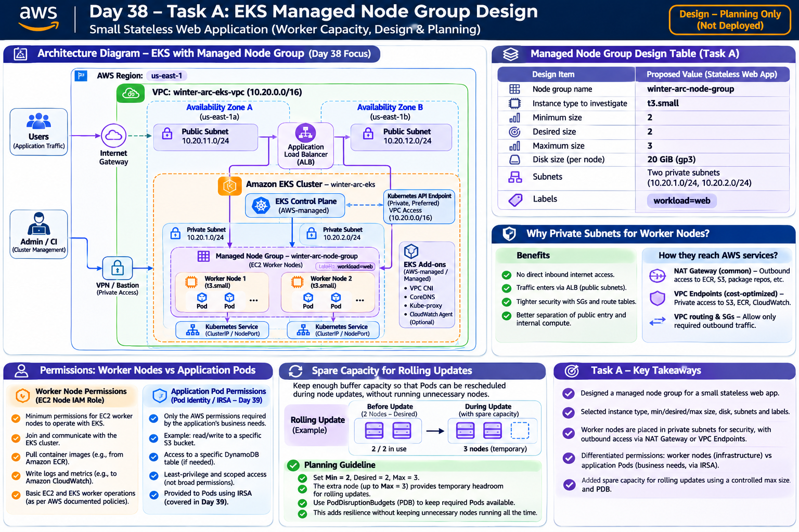

# Day 38 – AWS EKS: Managed Node Groups

## 1. Overview

**Day:** 38/90  
**Topic:** AWS EKS – Managed Node Groups  
**Platform:** Floci, AWS CLI, AWS Console, Ubuntu WSL, kubectl, Minikube  
**AWS Region for real AWS practice:** ap-south-1 (Mumbai)

### Objective

The objective of Day 38 is to understand how Amazon EKS managed node groups provide EC2 worker capacity to Kubernetes clusters.

This lab focuses on:

- Understanding EKS worker nodes and managed node groups.
- Designing a suitable node group for a small web application.
- Understanding minimum, desired and maximum node counts.
- Understanding worker-node IAM roles.
- Learning why worker nodes are commonly placed in private subnets.
- Inspecting EKS node groups using AWS CLI.
- Inspecting Kubernetes nodes, labels, taints and workloads.
- Practising CPU and memory resource requests.
- Understanding Pod scheduling and insufficient capacity.
- Comparing Deployment scaling with node group scaling.
- Learning common node-group troubleshooting techniques.

### Practice Environment

This lab uses three environments for different purposes.

| Environment | Purpose |
|---|---|
| Floci | Local AWS API simulation and AWS CLI practice |
| AWS Console | Real AWS VPC, IAM and EKS configuration learning |
| Minikube | Local Kubernetes node inspection and scheduling exercises |

**Important:** Floci is a local cloud emulator. Its simulated EKS API operations are not the same as provisioning real AWS-managed EC2 worker nodes. Minikube is used for actual local Kubernetes scheduling practice.

Real EKS clusters, EC2 worker nodes, NAT Gateways and other AWS resources can incur charges. Real cluster and node-group creation is optional and requires explicit account-owner approval.

---

## 2. Core Concepts

### 2.1 Worker Node

A worker node is a machine that provides CPU and memory resources for running Kubernetes Pods.

In Amazon EKS, worker nodes commonly run on Amazon EC2 instances.

### 2.2 Managed Node Group

An EKS managed node group is a group of EC2 worker nodes integrated with Amazon EKS management.

AWS helps manage important node-group lifecycle operations, including provisioning and updates.

### 2.3 Minimum, Desired and Maximum Size

These three settings control the capacity of a node group.

| Setting | Meaning |
|---|---|
| Minimum | Lowest permitted number of worker nodes |
| Desired | Target number of worker nodes |
| Maximum | Highest permitted number of worker nodes |

Example:

```text
Minimum:  2
Desired:  2
Maximum:  3
```

This means the node group should maintain two nodes, with capacity to scale up to three.

### 2.4 Node IAM Role

The node IAM role gives EC2 worker nodes the AWS permissions required for node operation.

It is separate from the IAM permissions required by application Pods.

### 2.5 Launch Template

A launch template is an optional EC2 configuration used to define settings such as:

- Instance type.
- Storage configuration.
- Instance configuration.
- Approved launch settings.

### 2.6 Labels

Labels are key-value pairs assigned to Kubernetes objects.

Example:

```text
workload=web
environment=training
```

Labels help Kubernetes identify and select appropriate nodes for workloads.

### 2.7 Taints and Tolerations

Taints prevent Pods from being scheduled on a node unless the Pods have matching tolerations.

Tolerations allow Pods to be considered for scheduling on appropriately tainted nodes.

### 2.8 Cluster Autoscaler

Cluster Autoscaler is a Kubernetes component that can adjust node group capacity when Pods cannot be scheduled because of insufficient resources, provided it is correctly configured.

### 2.9 Node Group Updates

EKS coordinates supported managed node group updates.

However, workload availability, spare capacity and Pod disruption planning remain important during updates.

---

## 3. Node Group Architecture

The architecture diagram for this task is saved in the same folder as this README.



### 3.1 Architecture Explanation

The architecture represents an EKS cluster with worker nodes distributed across two Availability Zones.

The main components are:

| Component | Purpose |
|---|---|
| AWS Region | Location where AWS resources are created |
| VPC | Isolated network for EKS resources |
| Availability Zones | Provide infrastructure resilience |
| Private Subnets | Host EC2 worker nodes |
| EKS Control Plane | Manages Kubernetes cluster operations |
| Managed Node Group | Manages EC2 worker-node capacity |
| EC2 Worker Nodes | Provide CPU and memory |
| Kubernetes Pods | Run containerized applications |
| Node IAM Role | Provides AWS permissions to worker nodes |

### 3.2 Management Flow

```text
Administrator
     |
     v
 AWS CLI / kubectl
     |
     v
 EKS API Endpoint
     |
     v
 EKS Control Plane
     |
     v
 Managed Node Group
     |
     v
 EC2 Worker Nodes
     |
     v
 Kubernetes Pods
```

### 3.3 Application Traffic Flow

```text
Users
  |
  v
AWS Load Balancer
  |
  v
Kubernetes Service
  |
  v
Application Pods
  |
  v
EC2 Worker Nodes
```

A load balancer is used when configured. It is not automatically created just because an EKS node group exists.

---

## 4. Task A – Node Group Design

### 4.1 Scenario

Design a managed node group for a small stateless web application running across at least two worker nodes.

A stateless application does not depend on data stored only inside an individual Pod or worker node. This makes it easier to replace or reschedule application Pods.

### 4.2 Node Group Design Table

| Configuration | Planned Value |
|---|---|
| EKS Cluster | winter-arc-eks |
| Node Group Name | winter-arc-node-group |
| Instance Type | t3.small (to investigate) |
| Minimum Nodes | 2 |
| Desired Nodes | 2 |
| Maximum Nodes | 3 |
| Disk Size | 20 GiB |
| Subnets | Two private subnets |
| Availability Zones | Two |
| Node Label | workload=web |
| Operating System | EKS-optimised Linux AMI |

These are proposed design values, not proof of actual AWS resources.

Check current EC2 pricing, availability, EKS compatibility and account limits before using them in a real deployment.

### 4.3 Why Use Private Subnets?

Worker nodes are commonly placed in private subnets because:

- They do not need direct inbound internet access.
- They can receive application traffic through an approved load balancer.
- Their security groups can restrict access to trusted components.
- They can use controlled outbound connectivity to reach required AWS services.

Private worker nodes may need NAT Gateways or VPC endpoints to access required services.

NAT Gateways can incur ongoing charges, so they must be considered in the cost plan.

### 4.4 Worker Permissions vs Application Permissions

| Identity | Responsibility |
|---|---|
| Worker Node IAM Role | Permissions required for node operation |
| Application Workload Identity | Permissions required by the application |
| Administrator IAM Identity | Permissions to administer AWS resources |

Application Pods should not automatically inherit broad worker-node permissions.

Day 39 covers workload identity and IRSA in more detail.

### 4.5 Spare Capacity During Updates

Suppose the node group has two desired nodes.

During a rolling update, Kubernetes may need additional capacity to reschedule Pods while old nodes are replaced.

If both nodes are fully occupied, some Pods may remain Pending.

A maximum of three allows the node group to scale up to an additional node, subject to the update strategy and available EC2 capacity.

---

## 5. Task B – Read-only AWS Inspection Using Floci

### 5.1 Why Floci?

Floci provides a local cloud environment for practising supported AWS API operations.

We use it to practise AWS CLI commands without creating real AWS resources or using real AWS credentials.

Floci's EKS API simulation must not be confused with a real AWS-managed EC2 node group.

### 5.2 Check Docker

Open Ubuntu WSL.

```bash
docker --version
```

Purpose: Checks whether Docker is installed.

```bash
docker info
```

Purpose: Checks whether the Docker engine is running and accessible.

### 5.3 Install Floci

Use the official installation command:

```bash
curl -fsSL https://floci.io/install.sh | sh
```

Purpose: Installs the Floci CLI.

### 5.4 Start Floci

```bash
floci start
```

Purpose: Starts the local cloud emulator.

### 5.5 Configure the Local AWS Environment

```bash
eval "$(floci env)"
```

Purpose: Loads Floci's AWS environment configuration into the current terminal session.

Check the endpoint:

```bash
echo "$AWS_ENDPOINT_URL"
```

Expected endpoint:

```text
http://localhost:4566
```

Always check that the terminal points to Floci before running AWS CLI commands intended for local simulation.

### 5.6 Verify AWS CLI

```bash
aws --version
```

Purpose: Checks the AWS CLI installation.

```bash
aws sts get-caller-identity
```

Purpose: Checks the identity returned by the local AWS emulator.

### 5.7 List EKS Clusters

```bash
aws eks list-clusters
```

Purpose: Lists EKS clusters known to the Floci environment.

On a fresh environment, the list should initially be empty.

### 5.8 Create a Local EKS Cluster

For local API practice, create a simulated cluster.

```bash
aws eks create-cluster \
  --name winter-arc-eks \
  --role-arn arn:aws:iam::000000000000:role/winter-arc-eks-cluster-role \
  --resources-vpc-config subnetIds=[],securityGroupIds=[] \
  --kubernetes-version 1.29
```

This is a Floci simulation command using placeholder IAM information and an empty VPC configuration supported by the documented local example.

It does not create a real AWS VPC or real AWS EKS control plane.

Check the cluster:

```bash
aws eks describe-cluster \
  --name winter-arc-eks
```

Purpose: Inspects the simulated cluster.

List clusters again:

```bash
aws eks list-clusters
```

Purpose: Confirms that the simulated cluster appears in the list.

### 5.9 Configure kubectl for the Floci Cluster

```bash
aws eks update-kubeconfig \
  --region us-east-1 \
  --name winter-arc-eks
```

Purpose: Configures the Kubernetes connection for the local simulated cluster.

Check the current context:

```bash
kubectl config current-context
```

Check nodes:

```bash
kubectl get nodes
```

Floci's real execution mode uses a local k3s Kubernetes cluster. Its metadata-only mode does not provide the same Kubernetes runtime.

### 5.10 Inspect the Node Group API

Floci documents EKS node-group API operations.

The following API requests can be used to inspect node-group information after a simulated node group has been created.

List node groups:

```bash
curl -s \
  "http://localhost:4566/clusters/winter-arc-eks/node-groups"
```

Inspect a specific node group:

```bash
curl -s \
  "http://localhost:4566/clusters/winter-arc-eks/node-groups/winter-arc-node-group"
```

These are Floci API requests, not AWS Console requests.

**Important:** A simulated node-group record does not prove that EC2 instances were provisioned or joined the Kubernetes cluster.

### 5.11 Real AWS Read-only Inspection Commands

These are the commands to use if a real EKS cluster and managed node group exist in your AWS account later.

List node groups:

```bash
aws eks list-nodegroups \
  --cluster-name YOUR_CLUSTER \
  --region ap-south-1
```

Describe a node group:

```bash
aws eks describe-nodegroup \
  --cluster-name YOUR_CLUSTER \
  --nodegroup-name YOUR_NODEGROUP \
  --region ap-south-1
```

These commands inspect real AWS resources and do not create, update or delete them.

Since no real EKS cluster exists in the account yet, record real AWS node-group inspection as not applicable.

---

## 6. Task C – Inspect Nodes and Workloads Using Minikube

This task uses the local Kubernetes cluster.

Minikube is used because it provides actual Kubernetes nodes and Pods for scheduling practice.

### 6.1 Check Minikube

```bash
minikube status
```

If the cluster is stopped:

```bash
minikube start
```

Check the current context:

```bash
kubectl config current-context
```

Switch to Minikube if necessary:

```bash
kubectl config use-context minikube
```

### 6.2 Inspect Nodes

```bash
kubectl get nodes -o wide
```

Purpose:

Displays node names, status, Kubernetes version, operating system and network information.

A healthy node should normally report:

```text
Ready
```

### 6.3 Inspect Node Labels

```bash
kubectl get nodes --show-labels
```

Purpose:

Displays labels assigned to each Kubernetes node.

Labels help Kubernetes select appropriate nodes for workloads.

### 6.4 Inspect Detailed Node Information

```bash
kubectl describe nodes
```

Purpose:

Displays:

- Node capacity.
- Allocatable CPU.
- Allocatable memory.
- Node conditions.
- Node labels.
- Node taints.
- Pods scheduled on the node.

### 6.5 Inspect Pods Across Namespaces

```bash
kubectl get pods -A -o wide
```

Purpose:

Lists Pods across all namespaces and displays the node on which each Pod is running.

### 6.6 Inspect Kubernetes Events

```bash
kubectl get events -A \
  --sort-by=.lastTimestamp
```

Purpose:

Displays recent events that can help diagnose scheduling and node problems.

---

## 7. Task D – Capacity and Scheduling Exercise

### 7.1 Create a Working Directory

```bash
mkdir -p ~/DevOps-Winter-Arc/Day38-EKS-Managed-Node-Groups
cd ~/DevOps-Winter-Arc/Day38-EKS-Managed-Node-Groups
```

### 7.2 Create the Deployment YAML

```bash
nano node-capacity-demo.yaml
```

Add:

```yaml
apiVersion: apps/v1
kind: Deployment
metadata:
  name: node-capacity-demo
spec:
  replicas: 2
  selector:
    matchLabels:
      app: node-capacity-demo
  template:
    metadata:
      labels:
        app: node-capacity-demo
    spec:
      containers:
        - name: nginx
          image: nginx:stable
          resources:
            requests:
              cpu: 100m
              memory: 128Mi
```

Save the file.

### 7.3 Understand the YAML

| Setting | Explanation |
|---|---|
| Deployment | Manages the application Pods |
| Replicas: 2 | Requests two application Pods |
| nginx:stable | Container image |
| CPU: 100m | Requests 0.1 CPU core |
| Memory: 128Mi | Requests 128 MiB memory |

Resource requests help Kubernetes determine which node has enough available capacity for a Pod.

### 7.4 Deploy the Application

```bash
kubectl apply -f node-capacity-demo.yaml
```

Check Deployment:

```bash
kubectl get deployments
```

Check Pods:

```bash
kubectl get pods -o wide
```

The NODE column shows where Kubernetes scheduled each Pod.

### 7.5 Inspect a Pod

```bash
kubectl describe pod POD_NAME
```

Replace POD_NAME with the actual Pod name.

Inspect:

- Node assignment.
- Resource requests.
- Conditions.
- Scheduling events.

### 7.6 Simulate Insufficient Capacity

Create another YAML file:

```bash
nano insufficient-capacity.yaml
```

Add:

```yaml
apiVersion: v1
kind: Pod
metadata:
  name: capacity-test
spec:
  containers:
    - name: nginx
      image: nginx:stable
      resources:
        requests:
          cpu: "100"
          memory: "1Ti"
```

The requested memory is intentionally much larger than a normal Minikube node can provide.

Apply:

```bash
kubectl apply -f insufficient-capacity.yaml
```

Inspect:

```bash
kubectl get pods
```

Describe:

```bash
kubectl describe pod capacity-test
```

Look at the Events section.

The Pod should remain Pending because the requested resources cannot fit on the available node.

This test demonstrates scheduling failure without intentionally consuming the requested memory.

Clean up:

```bash
kubectl delete -f insufficient-capacity.yaml
```

### 7.7 Deployment Scaling

Deployment scaling changes the number of application Pods.

```bash
kubectl scale deployment node-capacity-demo --replicas=3
```

Check:

```bash
kubectl get pods -o wide
```

Kubernetes now attempts to maintain three application Pods.

The worker-node capacity has not automatically changed.

### 7.8 Node Group Scaling

Node group scaling changes the number of EC2 worker nodes available to the cluster.

For example:

```text
Desired nodes: 2
New desired nodes: 3
```

In a real EKS environment, this changes the managed node group's worker capacity.

Minikube cannot perform real EC2 node group scaling. Floci can be used to practise supported EKS API operations, while Minikube demonstrates the Kubernetes scheduling effects.

### 7.9 Practise Node Labels

Add a label:

```bash
kubectl label nodes minikube workload=web
```

Inspect:

```bash
kubectl get nodes --show-labels
```

If the label already exists, use:

```bash
kubectl label nodes minikube workload=web --overwrite
```

### 7.10 Practise Taints

Add a taint:

```bash
kubectl taint nodes minikube dedicated=web:NoSchedule
```

Inspect:

```bash
kubectl describe node minikube
```

Look at the Taints section.

Remove the taint after the exercise:

```bash
kubectl taint nodes minikube dedicated=web:NoSchedule-
```

### 7.11 Clean Up the Test Deployment

```bash
kubectl delete -f node-capacity-demo.yaml
```

Verify:

```bash
kubectl get pods
```

---

## 8. AWS Console – VPC and IAM Preparation

This section covers real AWS website-based tasks.

These resources are separate from Floci. They are created in your actual AWS account.

### 8.1 Select the Region

1. Sign in to AWS Console.
2. Select Asia Pacific (Mumbai).
3. Confirm the Region is `ap-south-1`.
4. Search for VPC.

### 8.2 Create the VPC

1. Open VPC.
2. Select Your VPCs.
3. Click Create VPC.
4. Select VPC only.
5. Enter:

| Field | Value |
|---|---|
| Name | winter-arc-eks-vpc |
| IPv4 CIDR | 10.0.0.0/16 |
| IPv6 | No IPv6 CIDR |
| Tenancy | Default |

6. Click Create VPC.

### 8.3 Create Four Subnets

Open Subnets and click Create subnet.

Choose the newly created VPC.

| Subnet | Availability Zone | CIDR |
|---|---|---|
| eks-public-a | Mumbai AZ A | 10.0.1.0/24 |
| eks-public-b | Mumbai AZ B | 10.0.2.0/24 |
| eks-private-a | Mumbai AZ A | 10.0.11.0/24 |
| eks-private-b | Mumbai AZ B | 10.0.12.0/24 |

Use two distinct Availability Zones available in your account.

### 8.4 Create Internet Gateway

1. Open Internet Gateways.
2. Click Create internet gateway.
3. Name it `winter-arc-eks-igw`.
4. Create it.
5. Select the Internet Gateway.
6. Choose Actions → Attach to VPC.
7. Select `winter-arc-eks-vpc`.
8. Attach it.

### 8.5 Create Route Tables

Create two route tables:

```text
winter-arc-public-rt
winter-arc-private-rt
```

Public route table:

| Destination | Target |
|---|---|
| 10.0.0.0/16 | local |
| 0.0.0.0/0 | Internet Gateway |

Associate both public subnets with the public route table.

Associate both private subnets with the private route table.

Do not create a NAT Gateway just for this exercise. NAT Gateways can incur ongoing charges.

### 8.6 Create EKS Cluster IAM Role

1. Open IAM → Roles.
2. Click Create role.
3. Select AWS service.
4. Select EKS.
5. Select the EKS cluster use case.
6. Verify the trusted service is `eks.amazonaws.com`.
7. Attach `AmazonEKSClusterPolicy` if it is not already attached.
8. Name the role:

```text
winter-arc-eks-cluster-role
```

9. Create the role.

### 8.7 Create EC2 Node IAM Role

1. Open IAM → Roles.
2. Click Create role.
3. Select AWS service.
4. Choose EC2.
5. Attach the standard managed node-group policies:

```text
AmazonEKSWorkerNodePolicy
AmazonEC2ContainerRegistryPullOnly
AmazonEKS_CNI_Policy
```

6. Name the role:

```text
winter-arc-eks-node-role
```

7. Review and create it.

The CNI permissions can also be configured separately through a least-privilege workload identity design.

Creating these roles does not create EC2 instances or an EKS cluster.

---

## 9. Optional AWS Managed Node Group Creation

This is the real AWS task and requires account-owner approval.

### 9.1 Open EKS

1. Sign in to AWS Console.
2. Search for Amazon EKS.
3. Open the EKS service.
4. Select Clusters.

### 9.2 Create the EKS Cluster

Only after approval:

1. Click Create cluster.
2. Enter `winter-arc-eks`.
3. Select a currently supported Kubernetes version.
4. Select the EKS cluster IAM role.
5. Select the approved VPC.
6. Select the required subnets across two Availability Zones.
7. Configure API endpoint access.
8. Review the configuration and costs.
9. Create the cluster.

Wait until the cluster status becomes Active.

### 9.3 Create Managed Node Group

1. Open the cluster.
2. Select the Compute tab.
3. Click Add node group.
4. Enter `winter-arc-node-group`.
5. Select `winter-arc-eks-node-role`.
6. Select the approved private subnets.
7. Choose the approved EC2 instance type.
8. Configure:

```text
Minimum:  2
Desired:  2
Maximum:  3
```

9. Review storage and scaling configuration.
10. Review the expected cost.
11. Create the node group only after approval.

Wait until the node group status becomes Active.

### 9.4 Configure kubectl

After the real cluster and node group exist:

```bash
aws eks update-kubeconfig \
  --region ap-south-1 \
  --name winter-arc-eks
```

Verify:

```bash
kubectl config current-context
```

Check worker nodes:

```bash
kubectl get nodes -o wide
```

Expected node status:

```text
Ready
```

Do not use these real AWS commands while expecting them to target Floci. Keep local and real AWS environments separate.

---

## 10. Troubleshooting

| Problem | Possible Cause | Troubleshooting |
|---|---|---|
| Node group CREATE_FAILED | IAM role, subnet capacity, EC2 quota or instance availability | Inspect node group status and events |
| Nodes do not join | Node IAM role or cluster networking issue | Check IAM, routes, security groups and endpoint connectivity |
| Node NotReady | CNI, kubelet, runtime, disk or memory issue | Run kubectl describe node and inspect events |
| Pod Pending | Insufficient resources, taints, affinity or PVC problems | Run kubectl describe pod |
| InsufficientInstanceCapacity | EC2 capacity unavailable in selected AZ | Check approved alternative instance types or AZs |
| Update stalls | PodDisruptionBudget or replacement capacity issue | Inspect update status, events and workload availability |
| Floci fails to start | Docker unavailable or container startup failure | Check docker info and Floci status |
| kubectl cannot connect | Incorrect context or unavailable API endpoint | Check kubectl config current-context |
| ImagePullBackOff | Image name, registry authentication or network issue | Inspect Pod events and image configuration |

### Useful Troubleshooting Commands

Inspect nodes:

```bash
kubectl get nodes -o wide
```

Inspect Pods:

```bash
kubectl get pods -A
```

Inspect a Pod:

```bash
kubectl describe pod POD_NAME
```

Inspect node conditions:

```bash
kubectl describe node NODE_NAME
```

Inspect events:

```bash
kubectl get events -A \
  --sort-by=.lastTimestamp
```

Inspect a real EKS node group:

```bash
aws eks describe-nodegroup \
  --cluster-name YOUR_CLUSTER \
  --nodegroup-name YOUR_NODEGROUP \
  --region ap-south-1
```

---

## 11. Cost and Cleanup Plan

### Cost Considerations

The following AWS resources may incur charges:

- EKS cluster control plane.
- EC2 worker instances.
- EBS storage.
- NAT Gateways.
- Load balancers.
- Public IPv4 addresses.
- Data transfer.

An AWS Free Tier account does not guarantee that all EKS resources are free.

A budget alert is not a hard spending limit.

### Local Cleanup

Delete the Kubernetes test deployment:

```bash
kubectl delete -f node-capacity-demo.yaml
```

Delete the capacity test Pod if it still exists:

```bash
kubectl delete pod capacity-test --ignore-not-found
```

Remove the training taint if it still exists:

```bash
kubectl taint nodes minikube dedicated=web:NoSchedule-
```

Stop Minikube when finished:

```bash
minikube stop
```

### AWS Cleanup

If real AWS resources were created, follow the approved cleanup plan.

Inspect and remove resources as appropriate:

- EKS managed node groups.
- EKS cluster.
- Load balancers.
- NAT Gateways.
- EBS volumes.
- Elastic IP addresses.
- Other separately created resources.

Deleting the EKS cluster does not necessarily remove every related resource.

Do not delete the VPC if it contains resources from another lab.

---

## 12. Interview Questions and Answers

### Q1. What is an EKS managed node group?

A managed node group is a group of EC2 worker nodes integrated with Amazon EKS management.

### Q2. What is a worker node?

A worker node is a machine that provides CPU and memory resources for Kubernetes Pods.

### Q3. What do minimum, desired and maximum node counts mean?

Minimum is the lower capacity limit, desired is the target node count, and maximum is the upper capacity limit.

### Q4. What is the difference between Deployment scaling and node group scaling?

Deployment scaling changes the number of application Pods. Node group scaling changes the amount of worker-node capacity available to the cluster.

### Q5. What is a node IAM role?

It gives EC2 worker nodes the AWS permissions required for node operation and AWS integrations.

### Q6. Why are worker nodes commonly placed in private subnets?

Private subnets reduce direct internet exposure and allow network access to be controlled through approved routes and security rules.

### Q7. What is a launch template?

A launch template is an optional EC2 configuration that defines instance settings such as instance type and storage.

### Q8. Why can a Pod remain Pending?

A Pod may remain Pending because of insufficient CPU or memory, taints, affinity rules, storage constraints or other scheduling requirements.

### Q9. What does Node NotReady mean?

It means the node is registered with Kubernetes but is not reporting healthy readiness.

### Q10. What are node labels?

Labels are key-value pairs used to identify and select Kubernetes nodes for workloads.

### Q11. What is a taint?

A taint prevents Pods from scheduling on a node unless they have an appropriate toleration.

### Q12. What is a toleration?

A toleration allows a Pod to be considered for scheduling on a node with a matching taint.

### Q13. What is Cluster Autoscaler?

Cluster Autoscaler adjusts node group capacity when Pods cannot be scheduled due to insufficient resources, when correctly configured.

### Q14. What is the difference between capacity and allocatable resources?

Capacity represents the total resources reported by a node. Allocatable represents the resources available for Kubernetes workloads after system reservations.

### Q15. What happens when a Pod requests more memory than available?

The scheduler cannot place the Pod on a node that cannot satisfy its resource request, so the Pod may remain Pending.

### Q16. Why is spare capacity important during rolling updates?

Spare capacity helps Kubernetes reschedule workloads while existing nodes are updated or replaced.

### Q17. What is InsufficientInstanceCapacity?

It is an EC2 capacity problem where AWS cannot provide the requested instance type in the selected Availability Zone at that time.

### Q18. Does scaling Deployment replicas create new EC2 instances?

No. It changes the desired number of Pods. Additional worker nodes require separate node-capacity scaling.

### Q19. What happens during a managed node group update?

EKS coordinates supported updates to the worker nodes. Workload availability, disruption budgets and replacement capacity must still be considered.

### Q20. Why should application permissions be separate from worker-node permissions?

Separating permissions follows least privilege and prevents applications from receiving unnecessary AWS permissions.

---

## 13. Key Learnings

After completing Day 38, I understand:

- EKS managed node groups and worker nodes.
- Minimum, desired and maximum node capacity.
- Node IAM roles and their purpose.
- Why private subnets are commonly used for worker nodes.
- The importance of spare capacity during updates.
- How to inspect EKS API resources using Floci.
- How to inspect Kubernetes nodes and workloads.
- How to examine node labels, taints and conditions.
- How CPU and memory requests affect Pod scheduling.
- What happens when node capacity is insufficient.
- The difference between Deployment scaling and node group scaling.
- How labels, taints and tolerations influence scheduling.
- Common managed node group troubleshooting techniques.
- AWS cost and cleanup considerations.

---

## 14. Conclusion

Day 38 focused on Amazon EKS managed node groups and worker-node capacity.

I learned how managed node groups provide EC2 worker capacity, how minimum, desired and maximum node counts control scaling, and why worker nodes are commonly placed in private subnets.

I also practised AWS EKS API operations using Floci and Kubernetes node inspection and scheduling using Minikube.

The capacity exercise demonstrated how CPU and memory requests influence Pod placement and why a Pod may remain Pending when a node cannot satisfy its resource requirements.

Real AWS managed node group creation remains optional and requires explicit cost approval.

**Day 38 Complete – AWS EKS Managed Node Groups.**
