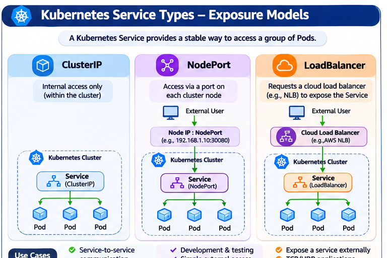
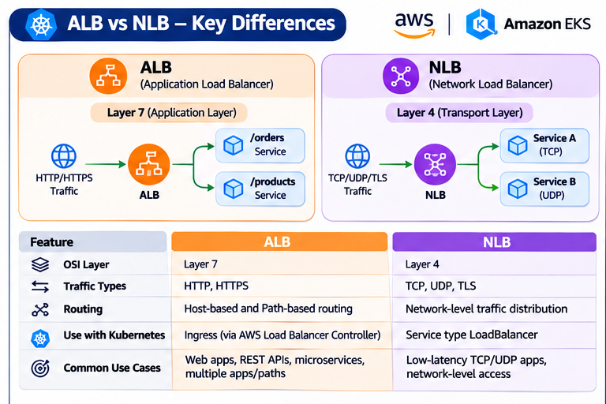
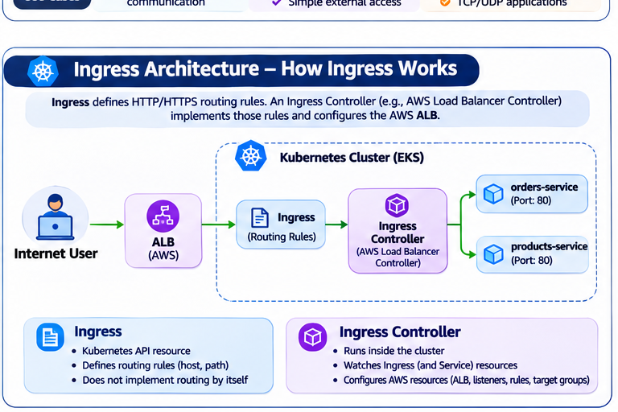
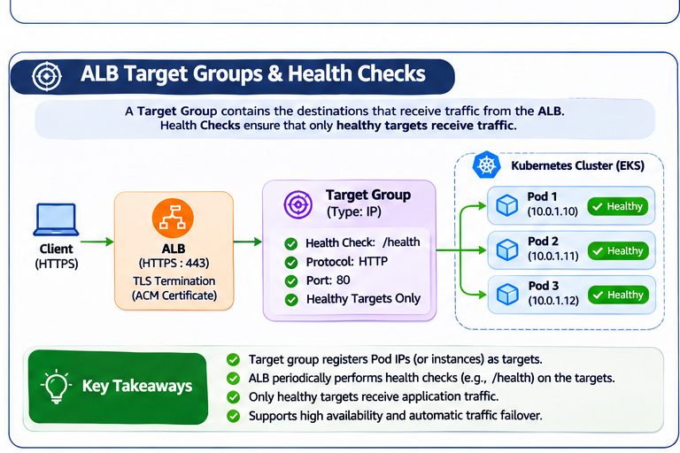
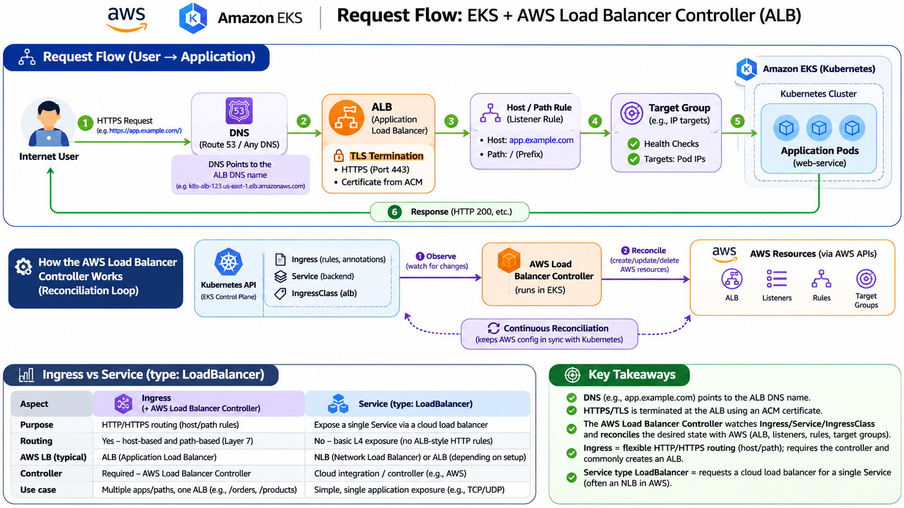

# Day 40 – AWS EKS: AWS Load Balancer Controller

**DevOps Winter Arc – 90 Days Challenge**  
**Week 6 – AWS EKS**  
**Day 40 / 90**

---

## Overview

Day 40 focuses on exposing Kubernetes applications safely using the AWS Load Balancer Controller.

In this task, we learn how external users access applications running inside Kubernetes, how AWS Application Load Balancers route HTTP/HTTPS traffic, and how the AWS Load Balancer Controller connects Kubernetes resources with AWS load-balancing infrastructure.

We also explore Kubernetes Service types, Ingress resources, target groups, health checks, DNS, TLS termination and request routing.

### Today's Topics

- Kubernetes Service types
- ClusterIP, NodePort and LoadBalancer
- Application Load Balancer (ALB)
- Network Load Balancer (NLB)
- Kubernetes Ingress
- AWS Load Balancer Controller
- Host-based and path-based routing
- DNS and TLS termination
- Target groups and health checks
- AWS networking and security prerequisites
- Ingress design and troubleshooting

### Environment Used

| Component | Purpose |
|---|---|
| Ubuntu WSL | Linux terminal |
| AWS CLI | AWS API commands |
| Floci | Local AWS cloud emulation |
| kubectl | Kubernetes management |
| Minikube / local Kubernetes | Kubernetes inspection and practice |
| AWS Management Console | AWS EKS and load-balancer interface |

**Important:** Floci is used for local AWS API emulation. Minikube is used for local Kubernetes exercises. Neither should be confused with a real AWS EKS deployment.

No real AWS EKS cluster, VPC, ALB, NLB, EC2 instances or networking resources are assumed to exist for this exercise.

---

# 1. Core Concepts

## 1.1 What is a Kubernetes Service?

A Kubernetes Service provides a stable way to access a group of Pods.

Pods can be created, deleted or replaced. Their IP addresses may change.

A Service provides a stable endpoint and forwards traffic to the Pods selected by its selector.

Kubernetes provides different Service types depending on how the application needs to be exposed.



Shows the three Kubernetes Service exposure methods:

- ClusterIP – Internal cluster communication.
- NodePort – Access through a port on each node.
- LoadBalancer – Requests a cloud load balancer.

Day 40 focuses on ClusterIP, NodePort and LoadBalancer.

## 1.2 ClusterIP

ClusterIP is the default Kubernetes Service type.

It exposes an application internally inside the Kubernetes cluster.

External users cannot directly access the Service through its ClusterIP unless another networking component provides access.

### Architecture

```text
        Kubernetes Cluster
       ____________________
      |                    |
      |   Application Pod  |
      |         ^          |
      |         |          |
      |     ClusterIP      |
      |      Service       |
      |                    |
      |____________________|

      Internal communication
```

### Example

```yaml
apiVersion: v1
kind: Service
metadata:
  name: web-service
spec:
  type: ClusterIP
  selector:
    app: web
  ports:
    - port: 80
      targetPort: 8080
```

### Explanation

- `type: ClusterIP` exposes the Service internally.
- `selector` identifies the Pods receiving traffic.
- `port` is the Service port.
- `targetPort` is the container port receiving traffic.

### Common use cases

- Internal APIs.
- Backend services.
- Database services.
- Communication between microservices.

## 1.3 NodePort

NodePort exposes a Service through a port on each Kubernetes node.

External traffic can reach the application using:

```text
NodeIP:NodePort
```

### Architecture

```text
        External User
              |
              v
       Kubernetes Node
              |
              v
        NodePort Service
              |
              v
        Application Pod
```

### Example

```yaml
apiVersion: v1
kind: Service
metadata:
  name: web-nodeport
spec:
  type: NodePort
  selector:
    app: web
  ports:
    - port: 80
      targetPort: 8080
      nodePort: 30080
```

### Explanation

- `type: NodePort` exposes the Service through node ports.
- `port` is the Service port.
- `targetPort` is the application container port.
- `nodePort` is the port exposed on the Kubernetes nodes.

The default Kubernetes NodePort range is commonly 30000–32767.

### Common use cases

- Development and testing.
- Simple external access.
- Environments where direct node-level access is appropriate.

## 1.4 LoadBalancer

A Service of type LoadBalancer requests a cloud load balancer.

In AWS, a Network Load Balancer is a common choice for this exposure method.

### Architecture

```text
        External User
              |
              v
       Cloud Load Balancer
              |
              v
       Kubernetes Service
         LoadBalancer
              |
              v
        Application Pod
```

### Example

```yaml
apiVersion: v1
kind: Service
metadata:
  name: web-loadbalancer
spec:
  type: LoadBalancer
  selector:
    app: web
  ports:
    - port: 80
      targetPort: 8080
```

### Explanation

When this Service is applied in a suitably configured cloud environment, Kubernetes cloud integration or a controller can provision a load balancer.

The Service exposes one application Service through the requested load-balancing infrastructure.

### Common use cases

- Exposing an application externally.
- Network-level traffic handling.
- TCP/UDP services.
- Applications that need a dedicated cloud load balancer.

## 1.5 What is an Application Load Balancer (ALB)?

An Application Load Balancer operates at Layer 7 of the OSI model.

It handles HTTP and HTTPS traffic.

It can route traffic using:

- Hostnames.
- URL paths.
- HTTP headers.
- Listener rules.

### Example

```text
app.example.com/orders
        |
        v
       ALB
        |
        v
   Host / Path Rule
        |
        v
   Orders Service
        |
        v
   Orders Pod
```

### Common use cases

- Web applications.
- REST APIs.
- Microservices.
- Multiple applications sharing one entry point.
- Host-based and path-based routing.

## 1.6 What is a Network Load Balancer (NLB)?

A Network Load Balancer operates at Layer 4.

It handles network traffic such as:

- TCP
- UDP
- TLS

It is designed for network-level traffic distribution rather than HTTP URL-based routing.

### Common use cases

- TCP applications.
- UDP applications.
- Low-latency network traffic.
- Applications requiring network-level load balancing.

### ALB vs NLB

| Feature | ALB | NLB |
|---|---|---|
| OSI Layer | Layer 7 | Layer 4 |
| Traffic | HTTP/HTTPS | TCP/UDP/TLS |
| Host-based routing | Yes | No |
| Path-based routing | Yes | No |
| Routing rules | HTTP listener rules | Network-level handling |
| Common Kubernetes use | Ingress | LoadBalancer Service |



Compares:

- ALB – Layer 7, HTTP/HTTPS, host-based and path-based routing.
- NLB – Layer 4, TCP/UDP/TLS and network-level traffic distribution.

**Remember:** ALB understands HTTP requests and can route using hostnames and paths. NLB operates at the network transport layer.

## 1.7 What is Kubernetes Ingress?

Ingress is a Kubernetes API resource that defines rules for external HTTP and HTTPS traffic entering a cluster.

It can route requests based on:

- Hostname.
- URL path.

Ingress does not implement routing by itself.

It needs an Ingress controller.



Explains how:

- An Ingress defines HTTP/HTTPS routing rules.
- The AWS Load Balancer Controller watches Kubernetes resources.
- The controller configures AWS load-balancing resources.
- Backend Services forward requests to application Pods.

### Example

```text
https://app.example.com/orders
              |
              v
            Ingress
              |
              v
        Orders Service
              |
              v
          Orders Pod
```

### Important distinction

| Ingress | Ingress Controller |
|---|---|
| Kubernetes API resource | Controller running in the cluster |
| Defines routing rules | Implements routing rules |
| Contains hostname and path configuration | Watches Kubernetes resources |
| Does not create an ALB by itself | Can configure AWS load-balancer infrastructure |

## 1.8 What is the AWS Load Balancer Controller?

The AWS Load Balancer Controller is a Kubernetes controller that watches supported Kubernetes resources and configures AWS load balancers.

It can manage:

- Application Load Balancers.
- Network Load Balancers.
- Listeners.
- Listener rules.
- Target groups.
- Related security configuration.

It observes resources such as:

- Ingress.
- Service.
- IngressClass.

### How it works

1. A developer creates or updates a Kubernetes Ingress.
2. The controller watches the Kubernetes API.
3. It detects the resource change.
4. It checks the configuration and prerequisites.
5. It calls AWS APIs.
6. It creates or updates the required load-balancer resources.
7. It updates Kubernetes status when appropriate.

This process is called reconciliation.

### What is reconciliation?

Reconciliation means continuously comparing the desired configuration in Kubernetes with the actual infrastructure state.

The controller attempts to make AWS resources match the desired Kubernetes configuration.

For example:

If an Ingress requires an ALB listener rule, the controller checks whether that rule exists and creates or updates it as necessary.

### Why does the controller need IAM permissions?

The controller must communicate with AWS APIs.

It needs permissions to manage the AWS resources required by its supported configurations.

It should use a dedicated IAM role with scoped permissions, rather than AdministratorAccess.

## 1.9 What are Target Groups?

A target group contains the destinations that receive traffic from a load balancer.

Depending on the configuration, targets can be:

- EC2 instances.
- Kubernetes Pod IP addresses.

### Example

```text
           ALB
            |
            v
       Target Group
        /       \
       v         v
    Pod 1      Pod 2
```

The ALB forwards traffic to registered targets.

## 1.10 What are Health Checks?



Shows how an ALB forwards traffic to registered targets, how Pod IP targets work, and how health checks determine which targets can receive traffic.

Health checks determine whether a target is healthy and can receive traffic.

The load balancer periodically checks configured targets.

For an HTTP application, a health-check endpoint might be:

```text
/health
```

A healthy target can receive traffic.

An unhealthy target is generally removed from normal traffic routing until it becomes healthy again.

Health checks depend on:

- Health-check protocol.
- Health-check port.
- Health-check path.
- Expected response codes.
- Network connectivity.
- Application readiness.

## 1.11 DNS and TLS Termination

### DNS

DNS maps a human-readable domain name to a destination.

Example:

```text
app.example.com
        |
        v
ALB DNS Name
```

For a real AWS deployment, a DNS record is configured to point to the ALB DNS name.

Route 53 Alias records are commonly used when Route 53 manages the domain.

### TLS Termination

TLS termination is the point where encrypted HTTPS traffic is decrypted.

In a common ALB architecture:

1. The user sends an HTTPS request.
2. The ALB receives traffic on port 443.
3. The ALB uses an ACM certificate.
4. TLS is terminated at the ALB.
5. The ALB forwards traffic to the target group.

The backend connection can use HTTP or HTTPS depending on the configuration.

---

# 2. Modern Architecture – ALB Request Flow

The architecture diagram below represents the complete Day 40 request flow, DNS resolution, TLS termination, controller reconciliation and the difference between Ingress and Service type LoadBalancer.



Shows the complete request path:

Internet User → DNS → ALB Listener → Host/Path Rule → Target Group → Application Pod → Response.

It also illustrates TLS termination and the AWS Load Balancer Controller reconciliation process.

### Request Flow

```text
Internet User
      |
      | HTTPS Request
      v
DNS: app.example.com
      |
      | Resolves to ALB DNS Name
      v
Application Load Balancer
      |
      | HTTPS Listener :443
      | TLS Termination
      | ACM Certificate
      v
Host / Path Rule
      |
      | Host: app.example.com
      | Path: /
      v
Target Group
      |
      | Health Checks
      | Pod IP Targets
      v
Application Pod
      |
      v
HTTP Response
      |
      v
ALB
      |
      v
Internet User
```

### Request flow explanation

**Step 1 – Internet user**

A user opens:

```text
https://app.example.com/
```

**Step 2 – DNS resolution**

DNS resolves `app.example.com` to the ALB DNS name.

**Step 3 – ALB listener**

The ALB receives the HTTPS request on port 443.

**Step 4 – TLS termination**

The ALB uses the configured ACM certificate to terminate HTTPS.

**Step 5 – Host/path rule**

The ALB evaluates the listener rule.

Example:

```text
Host: app.example.com
Path: /
```

**Step 6 – Target group**

The request is forwarded to a healthy target in the target group.

**Step 7 – Application Pod**

The application Pod receives the request and processes it.

**Step 8 – Response**

The application response returns through the load balancer to the user.

## 2.1 AWS Load Balancer Controller Reconciliation Flow

The controller manages the AWS resources required by Kubernetes routing configuration.

```text
          Kubernetes API
                |
                v
       Kubernetes Resources
                |
       +--------+---------+
       |        |         |
       v        v         v
    Ingress  Service  IngressClass
       |        |         |
       +--------+---------+
                |
                v
       AWS Load Balancer
           Controller
                |
                v
        AWS API Operations
                |
       +--------+---------+
       |        |         |
       v        v         v
      ALB    Listeners   Rules
                |
                v
           Target Groups
                |
                v
       Continuous Reconciliation
```

The controller watches Kubernetes resources and reconciles AWS infrastructure when the desired configuration changes.

**Important:** The controller is part of the infrastructure management path. It is not normally in the direct application request path.

---

# 3. Task A – Draw the Request Flow

## Objective

Understand the complete request flow:

```text
Internet User
    →
ALB Listener
    →
Host / Path Rule
    →
Target Group
    →
Application Pod
    →
Response
```

Also identify:

- Where DNS points.
- Where HTTPS/TLS terminates.
- How the AWS Load Balancer Controller observes Kubernetes resources.
- How the controller reconciles AWS configuration.
- How Ingress differs from a Service of type LoadBalancer.

### Part A – DNS location

The DNS record for the application points to the ALB DNS name.

Example:

```text
app.example.com
       |
       v
ALB DNS Name
```

DNS does not normally point directly to an application Pod.

### Part B – TLS termination

TLS termination happens at the ALB when using the common HTTPS listener architecture.

```text
User
 |
 | HTTPS :443
 v
ALB
 |
 | TLS termination using ACM certificate
 v
Target Group
 |
 | Backend traffic
 v
Application Pod
```

### Part C – Controller observation

The AWS Load Balancer Controller watches Kubernetes resources.

When a supported Ingress or Service changes, the controller checks the desired configuration and reconciles the associated AWS resources.

### Part D – Ingress vs LoadBalancer Service

Ingress:

- Defines HTTP/HTTPS routing.
- Supports hostname and path rules.
- Commonly uses an ALB through the AWS Load Balancer Controller.

Service type LoadBalancer:

- Requests a cloud load balancer for a Service.
- Does not itself define ALB-style host/path routing.
- An NLB is a common AWS choice.

---

# 4. Task B – Compare Exposure Methods

## Objective

Compare ClusterIP, NodePort, LoadBalancer and Ingress.

| Method | Exposure | Main purpose |
|---|---|---|
| ClusterIP | Internal cluster | Service-to-service communication |
| NodePort | Node IP and port | Direct node-level access |
| LoadBalancer | Cloud load balancer | Expose an individual Service |
| Ingress + AWS Load Balancer Controller | HTTP/HTTPS through ALB | Host/path routing |

### ClusterIP

Use when an application should only be reachable inside the cluster.

### NodePort

Use when traffic needs to enter through a node IP and assigned port.

### LoadBalancer

Use when an individual Service needs a cloud load balancer.

### Ingress + ALB

Use when multiple application routes need centralized HTTP/HTTPS routing.

### Example scenario

Suppose an application contains:

```text
app.example.com/
app.example.com/orders
app.example.com/products
```

An ALB can use host and path rules to route these requests to the correct backend Services.

This is one of the main benefits of Ingress.

---

# 5. Task C – Inspect a Kubernetes Cluster (Read-only)

## Objective

Inspect the existing Kubernetes cluster and identify:

- Nodes.
- Services.
- Ingress resources.
- Pods.
- Service types.
- Service ports.
- Selectors.
- Endpoints.
- Kubernetes events.

These commands inspect resources. They do not create AWS load balancers.

## Step 1 – Confirm Kubernetes context

```bash
kubectl config current-context
```

This identifies the cluster currently used by kubectl.

For example, if the context is `minikube`, the commands inspect Minikube rather than a real EKS cluster.

## Step 2 – Inspect nodes

```bash
kubectl get nodes -o wide
```

This displays:

- Node name.
- Status.
- Kubernetes version.
- Internal IP.
- External IP, if available.
- Operating system.
- Container runtime.

## Step 3 – Inspect Services

```bash
kubectl get svc -A
```

This displays Services across all namespaces.

Example:

```text
NAMESPACE   NAME         TYPE        CLUSTER-IP      PORT(S)
default     kubernetes   ClusterIP   10.96.0.1       443/TCP
dev         web-service  ClusterIP   10.96.120.10    80/TCP
```

The output depends on your cluster.

Understand:

- Namespace: location of the Service.
- Name: Service name.
- Type: ClusterIP, NodePort or LoadBalancer.
- Cluster-IP: internal virtual IP.
- Ports: exposed Service ports.

## Step 4 – Inspect Ingress resources

```bash
kubectl get ingress -A
```

If no Ingress exists, Kubernetes may return:

```text
No resources found
```

This is acceptable.

Do not create an AWS load balancer just to produce inspection output.

## Step 5 – Inspect Pods

```bash
kubectl get pods -A
```

This displays Pods across all namespaces.

Check their status:

- Running
- Pending
- ContainerCreating
- CrashLoopBackOff
- Completed

## Step 6 – Choose one Service

First:

```bash
kubectl get svc -A
```

Choose an existing Service.

Inspect it:

```bash
kubectl describe svc SERVICE_NAME -n NAMESPACE
```

Replace the placeholders with the actual Service name and namespace.

Record:

- Service type.
- Service ports.
- Selector.
- Cluster IP.
- Endpoints.

## Step 7 – Inspect endpoints

```bash
kubectl get endpoints SERVICE_NAME -n NAMESPACE
```

Endpoints show the backend addresses associated with the Service.

If no endpoints appear, inspect the Service selector and matching Pods.

## Step 8 – Inspect an Ingress

Only if an Ingress exists:

```bash
kubectl describe ingress INGRESS_NAME -n NAMESPACE
```

This displays:

- Ingress class.
- Host rules.
- Path rules.
- Backend Services.
- Events.
- Load balancer address, if assigned.

## Step 9 – Inspect events

```bash
kubectl get events -n NAMESPACE --sort-by=.lastTimestamp
```

Events help identify errors involving:

- Scheduling.
- Pod readiness.
- Services.
- Ingress resources.
- Controller operations.

---

# 6. Task D – Design an Ingress

## Objective

Design an Ingress for the following application:

| Setting | Value |
|---|---|
| Namespace | `demo` |
| Service | `web-service` |
| Service port | `80` |
| Host | `app.example.com` |
| Path | `/` |
| Path type | `Prefix` |
| IngressClass | `alb` |

This is a design exercise. Do not apply it to AWS without approval.

## Step 1 – Understand the IngressClass

The IngressClass identifies the controller that should handle an Ingress.

For this design:

```yaml
ingressClassName: alb
```

The AWS Load Balancer Controller must be installed and configured to handle the `alb` class in a real EKS cluster.

Writing `alb` in YAML does not install the controller.

## Step 2 – Create the Ingress YAML

Create:

`day40-ingress.yaml`

```bash
nano day40-ingress.yaml
```

Paste:

```yaml
apiVersion: networking.k8s.io/v1
kind: Ingress
metadata:
  name: web-ingress
  namespace: demo
  annotations:
    alb.ingress.kubernetes.io/scheme: internet-facing
    alb.ingress.kubernetes.io/target-type: ip
spec:
  ingressClassName: alb
  rules:
    - host: app.example.com
      http:
        paths:
          - path: /
            pathType: Prefix
            backend:
              service:
                name: web-service
                port:
                  number: 80
```

Save using:

```text
Ctrl + O
Enter
Ctrl + X
```

## Step 3 – Understand each YAML section

### API version and kind

```yaml
apiVersion: networking.k8s.io/v1
kind: Ingress
```

Defines the Kubernetes Ingress API resource.

### Metadata

```yaml
metadata:
  name: web-ingress
  namespace: demo
```

The Ingress is named `web-ingress` and belongs to the `demo` namespace.

### Annotations

```yaml
annotations:
  alb.ingress.kubernetes.io/scheme: internet-facing
  alb.ingress.kubernetes.io/target-type: ip
```

`internet-facing` requests an internet-facing ALB.

`ip` means the target group registers Pod IP addresses directly.

These annotations are specific to the AWS Load Balancer Controller.

They do not create an ALB in Minikube by themselves.

### IngressClass

```yaml
ingressClassName: alb
```

Identifies the intended ALB Ingress controller.

### Host rule

```yaml
host: app.example.com
```

Matches requests with this hostname.

### Path rule

```yaml
path: /
pathType: Prefix
```

Matches the root path and paths beneath it.

### Backend

```yaml
backend:
  service:
    name: web-service
    port:
      number: 80
```

Routes matching traffic to the `web-service` Service on port 80 in the same namespace.

## Step 4 – Verify the design file

```bash
cat day40-ingress.yaml
```

Do not run `kubectl apply` for this design-only task.

Applying it to Minikube would create a Kubernetes Ingress object, but without a compatible Ingress controller it would not create a functional AWS ALB.

## Step 5 – DNS considerations

The DNS record should resolve:

```text
app.example.com
```

to the ALB DNS name after the ALB has been provisioned.

A Route 53 Alias record is commonly used when Route 53 manages the domain.

## Step 6 – TLS certificate considerations

For HTTPS:

- Obtain an appropriate certificate in AWS Certificate Manager.
- Ensure the certificate covers `app.example.com`.
- Configure the ALB HTTPS listener on port 443.
- Configure the appropriate certificate ARN in the controller's Ingress configuration.
- Decide whether backend traffic uses HTTP or HTTPS.

The current sample YAML does not configure TLS.

## Step 7 – Subnet considerations

The AWS Load Balancer Controller must be able to discover suitable subnets.

For an internet-facing ALB:

- Suitable public subnets must be available.
- Routing to an internet gateway must be configured.
- Subnet discovery tags must be correct.

For an internal ALB, suitable private subnets and internal routing are needed.

## Step 8 – Security-group considerations

Security groups must allow the intended traffic.

For example:

- ALB inbound HTTPS on port 443 from intended clients.
- ALB-to-target traffic on the application port.
- Appropriate health-check traffic.
- No unnecessary public access to application targets.

## Step 9 – Health-check considerations

The ALB must be able to reach healthy application targets.

Check:

- Target type.
- Service port.
- Pod IP reachability.
- Health-check protocol.
- Health-check path.
- Expected status codes.
- Security-group rules.

## Step 10 – Verify a real approved deployment

Only after the controller and AWS resources have been configured:

```bash
kubectl get ingress -n demo
```

Inspect:

```bash
kubectl describe ingress web-ingress -n demo
```

Then verify:

1. ALB exists in AWS.
2. Listener configuration is correct.
3. Host/path rules are correct.
4. Target group has registered targets.
5. Targets are healthy.
6. DNS resolves to the ALB.
7. Application responds correctly.

---

# 7. Task E – Optional AWS Load Balancer Controller Lab

## Objective

Install and configure the AWS Load Balancer Controller on an existing approved EKS cluster.

**Approval required:** This task can create billable AWS resources.

No real EKS cluster is assumed to exist for this exercise, so this section is a plan rather than an executed AWS deployment.

## Step 1 – Check prerequisites

Before installation:

- Confirm an existing EKS cluster.
- Confirm Kubernetes version compatibility.
- Review the official AWS installation prerequisites.
- Confirm suitable VPC and subnet configuration.
- Confirm cluster networking.

## Step 2 – Configure IAM permissions

The controller requires AWS API permissions.

Use:

- A dedicated IAM role.
- IRSA or EKS Pod Identity, as appropriate.
- A scoped controller policy.

Do not use AdministratorAccess for routine controller operations.

## Step 3 – Verify networking

Check:

- Subnet discovery tags.
- Public or private subnet selection.
- Security groups.
- DNS.
- Routing.
- Pod IP reachability.

## Step 4 – Install the controller

Follow the current official AWS EKS documentation for the cluster version and selected identity method.

Do not use an old controller version or an outdated IAM policy without checking compatibility.

## Step 5 – Apply a reviewed Ingress

After the controller is running, apply the reviewed Ingress configuration.

Inspect:

```bash
kubectl get ingress -n demo
```

```bash
kubectl describe ingress web-ingress -n demo
```

Inspect controller Pods and logs:

```bash
kubectl get pods -n kube-system
```

Find the AWS Load Balancer Controller Pod and inspect its logs:

```bash
kubectl logs CONTROLLER_POD_NAME -n kube-system
```

## Step 6 – Verify AWS resources

Check:

- ALB.
- Listener.
- Listener rules.
- Target group.
- Registered targets.
- Target health.
- DNS.
- Application response.

## Step 7 – Cleanup

Delete only the lab Ingress and resources created for the approved lab.

Verify that associated AWS load-balancer resources have been removed.

Continue checking billing until the resources are gone.

### Cost warning

ALBs, NLBs, data processing, public IPv4 addresses, EKS control planes, EC2 nodes and network components can incur charges.

A budget alert is not a hard spending cap.

Do not create real AWS resources without account-owner approval.

---

# 8. Troubleshooting

## Problem 1 – No Ingress address

Possible reasons:

- IngressClass is incorrect.
- Controller is not installed.
- Controller Pods are not running.
- IAM permissions are missing.
- Subnet discovery failed.
- Controller events contain errors.

Check:

```bash
kubectl get ingress -A
```

```bash
kubectl describe ingress INGRESS_NAME -n NAMESPACE
```

```bash
kubectl get pods -n kube-system
```

Inspect controller logs if the controller exists.

## Problem 2 – ALB not created

Possible reasons:

- AWS Load Balancer Controller is not installed.
- IAM role lacks required permissions.
- Subnet tags are incorrect.
- Security-group configuration is invalid.
- Cluster networking is incomplete.

Inspect Kubernetes events and controller logs.

## Problem 3 – Unhealthy targets

Possible reasons:

- Wrong target type.
- Incorrect Service port.
- Pods are not ready.
- Health-check path is incorrect.
- Health-check port is incorrect.
- Security groups block traffic.

Check:

```bash
kubectl get pods -A
```

```bash
kubectl describe svc web-service -n demo
```

## Problem 4 – 404 response

Possible reasons:

- Host rule does not match.
- Path rule does not match.
- Listener rules are incorrect.
- Backend Service name is incorrect.
- Backend Service port is incorrect.

Check:

```bash
kubectl describe ingress web-ingress -n demo
```

## Problem 5 – No connectivity

Check:

- DNS resolution.
- ALB listener.
- Target health.
- Security groups.
- Network ACLs.
- Application readiness.
- Backend connectivity.

Useful commands:

```bash
kubectl get svc -A
```

```bash
kubectl get pods -A
```

```bash
kubectl get events -A --sort-by=.lastTimestamp
```

---

# 9. Interview Questions and Answers

### 1. What is the difference between ClusterIP and NodePort?

ClusterIP exposes a Service internally within the cluster. NodePort exposes the Service through a port on each Kubernetes node.

### 2. What is a LoadBalancer Service?

It requests a cloud load balancer to expose an individual Kubernetes Service.

### 3. What is Ingress?

Ingress is a Kubernetes API resource that defines HTTP/HTTPS routing rules based on hostnames and paths.

### 4. What is an Ingress controller?

An Ingress controller watches Ingress resources and implements their routing configuration.

### 5. What is the AWS Load Balancer Controller?

It is a Kubernetes controller that manages supported AWS load-balancer resources based on Kubernetes configuration.

### 6. What is the difference between ALB and NLB?

ALB operates at Layer 7 and supports HTTP/HTTPS host/path routing. NLB operates at Layer 4 and handles network traffic such as TCP, UDP and TLS.

### 7. Why is ALB commonly used with Ingress?

ALB supports HTTP/HTTPS listener rules, host-based routing and path-based routing.

### 8. Why is NLB commonly used with Service type LoadBalancer?

NLB provides network-level load balancing and is suitable for services requiring TCP, UDP or TLS traffic handling.

### 9. What is a target group?

A target group contains the destinations that receive traffic from a load balancer, such as EC2 instances or Pod IP addresses.

### 10. What is a health check?

A health check determines whether a registered target is healthy and able to receive traffic.

### 11. What is TLS termination?

TLS termination is where encrypted HTTPS traffic is decrypted, commonly at the ALB using an ACM certificate.

### 12. Where does DNS point in an ALB architecture?

The application DNS name resolves to the ALB DNS name.

### 13. Why might an Ingress exist without an ALB address?

Possible reasons include a missing Ingress controller, incorrect IngressClass, IAM permission problems, subnet discovery issues or controller reconciliation errors.

### 14. What is reconciliation?

Reconciliation is the process of comparing desired Kubernetes configuration with actual AWS infrastructure and making supported changes to keep them synchronized.

### 15. Does creating an Ingress automatically create an ALB?

No. A compatible Ingress controller, such as the AWS Load Balancer Controller, must be installed and configured with the required IAM and networking prerequisites.

### 16. What is the difference between an Ingress and a Service of type LoadBalancer?

Ingress defines HTTP/HTTPS host and path routing. A LoadBalancer Service requests a cloud load balancer for an individual Service.

### 17. What does `alb.ingress.kubernetes.io/target-type: ip` mean?

It tells the AWS Load Balancer Controller to register Pod IP addresses as targets.

### 18. Why should the controller not use AdministratorAccess?

The controller should receive only the permissions necessary to manage its required AWS resources. This follows the principle of least privilege.

---

# 10. Key Takeaways

1. ClusterIP provides internal Kubernetes Service access.
2. NodePort exposes a Service through a port on each node.
3. LoadBalancer requests a cloud load balancer for an individual Service.
4. Ingress defines HTTP/HTTPS routing rules.
5. An Ingress controller implements those routing rules.
6. ALB supports Layer 7 host-based and path-based routing.
7. NLB provides Layer 4 network load balancing.
8. DNS points the application domain to the ALB DNS name.
9. HTTPS can terminate at the ALB using an ACM certificate.
10. Target groups contain the destinations receiving traffic.
11. Health checks identify healthy targets.
12. The AWS Load Balancer Controller watches Kubernetes resources and reconciles AWS infrastructure.
13. The controller needs a dedicated IAM role with appropriate permissions.
14. Subnets, security groups, DNS and cluster networking must be configured correctly.
15. Real AWS load-balancer resources can incur charges.

**Day 40 – Key Learning:** Kubernetes Ingress defines how external HTTP/HTTPS traffic should reach applications. The AWS Load Balancer Controller observes those Kubernetes resources and configures AWS load-balancing infrastructure to implement the desired routing.
