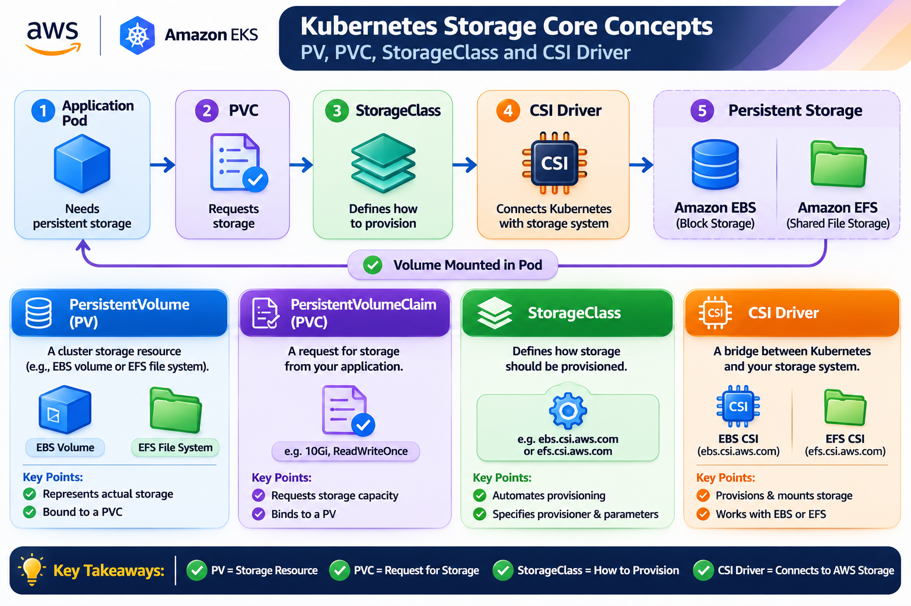
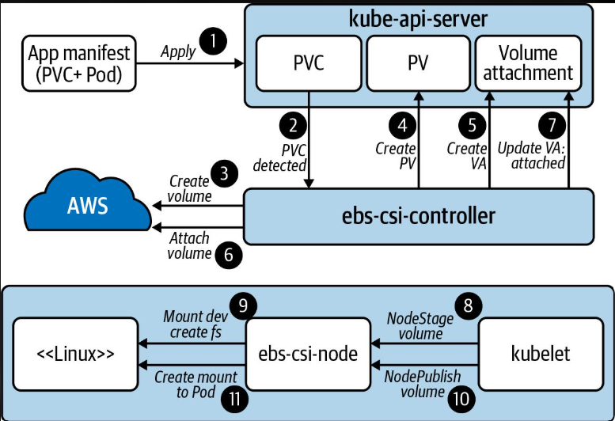
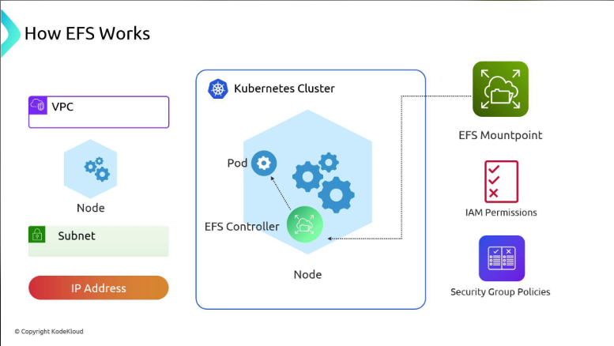
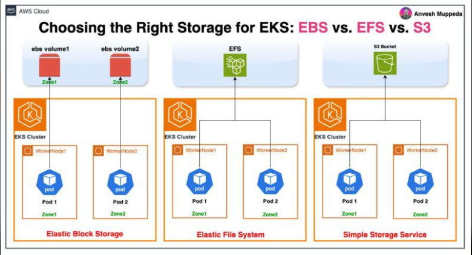

# Day 41 – AWS EKS: EBS & EFS Storage

## Overview

Day 41 focuses on persistent storage in Amazon Elastic Kubernetes Service (EKS). Kubernetes Pods are temporary by nature, so data stored only inside a container's writable layer may be lost when the container is replaced.

To retain application data, Kubernetes uses PersistentVolumes (PV), PersistentVolumeClaims (PVC), StorageClasses, and Container Storage Interface (CSI) drivers.

Amazon EBS and Amazon EFS provide persistent storage for workloads running on EKS.

This day covers:

- Kubernetes persistent storage concepts.
- PersistentVolume (PV), PersistentVolumeClaim (PVC), and StorageClass.
- Amazon EBS and Amazon EFS.
- EBS CSI and EFS CSI drivers.
- Static and dynamic storage provisioning.
- Designing EBS-backed and EFS-backed storage configurations.
- IAM, networking, and security-group considerations.
- Storage inspection and troubleshooting.

---

# 1. Core Concepts – Kubernetes Storage

## 1.1 Why Do Kubernetes Pods Need Persistent Storage?

Kubernetes Pods are designed to be temporary and replaceable.

When a container is restarted or a Pod is recreated, data stored only in its writable container layer may disappear.

For example:

- A database needs to retain records.
- A web application needs to preserve uploaded files.
- A stateful application needs persistent application data.
- Multiple web Pods may need access to the same files.

Persistent storage allows data to survive beyond the lifecycle of an individual container or Pod.

## 1.2 PersistentVolume (PV)

A PersistentVolume is a storage resource available to the Kubernetes cluster.

It represents actual storage capacity that can be used by applications.

A PV can be backed by:

- Amazon EBS.
- Amazon EFS.
- Other supported storage systems.

Key characteristics:

- Represents actual storage.
- Has a defined capacity.
- Supports access modes.
- Has a storage lifecycle and reclaim policy.
- Can be created manually or dynamically provisioned.

Example:

A 20Gi EBS volume can be represented as a PersistentVolume.

## 1.3 PersistentVolumeClaim (PVC)

A PersistentVolumeClaim is a request for storage made by an application or workload.

Instead of directly managing the underlying storage, a Pod references a PVC.

A PVC specifies:

- Required storage capacity.
- Access mode.
- StorageClass, when dynamic provisioning is used.

Example:

A database workload requests 20Gi of storage with ReadWriteOnce access.

Key characteristics:

- A namespaced Kubernetes resource.
- Requests storage capacity.
- Can bind to an existing PV.
- Can trigger dynamic provisioning through a StorageClass.
- Separates application configuration from the underlying storage implementation.

## 1.4 StorageClass

A StorageClass defines how storage should be dynamically provisioned.

It provides information about the provisioner and storage-specific parameters.

For example, an EBS StorageClass may define:

- EBS CSI provisioner.
- Volume type.
- Filesystem type.
- Reclaim policy.
- Volume binding mode.

An EFS StorageClass may define:

- EFS CSI provisioner.
- File system configuration.
- Access point provisioning parameters.

Important:

StorageClass names and parameters depend on the cluster setup. Never assume that a StorageClass named `gp2`, `gp3`, `ebs-sc`, or `efs-sc` exists.

Inspect the cluster before using a StorageClass.

## 1.5 CSI Driver

CSI stands for Container Storage Interface.

It is a standard interface that allows Kubernetes to communicate with external storage systems.

CSI drivers allow Kubernetes to:

- Provision storage.
- Attach or connect storage.
- Mount storage into Pods.
- Unmount storage.
- Manage supported storage lifecycle operations.

For AWS EKS, the two important CSI drivers are:

| CSI Driver | Purpose |
|---|---|
| EBS CSI | Provisions and manages Amazon EBS volumes |
| EFS CSI | Provisions and mounts Amazon EFS file systems |

Driver names:

- EBS: `ebs.csi.aws.com`
- EFS: `efs.csi.aws.com`

## 1.6 How PV, PVC, StorageClass and CSI Work Together



The general workflow is:

1. An application Pod needs persistent storage.
2. The application references a PVC.
3. The PVC requests storage capacity and an access mode.
4. The StorageClass defines how the storage should be provisioned.
5. The CSI driver communicates with the external storage system.
6. The storage is provisioned or an existing volume is connected.
7. Kubernetes makes the volume available to the Pod.

### Quick Comparison

| Component | Responsibility |
|---|---|
| PV | Represents actual storage |
| PVC | Requests storage |
| StorageClass | Defines provisioning configuration |
| CSI Driver | Connects Kubernetes to external storage |

---

# 2. Amazon EBS – Elastic Block Store

## 2.1 What Is Amazon EBS?

Amazon Elastic Block Store (EBS) is a block storage service provided by AWS.

It provides persistent disk volumes for compute workloads, including Kubernetes workloads running on Amazon EKS.

Think of EBS as a virtual hard disk that can be attached to an EC2 instance.

Important characteristics:

- Persistent block storage.
- Suitable for database and stateful workloads.
- Supports different volume types and performance options.
- EBS volumes are Availability Zone-specific.
- Typically used with ReadWriteOnce access in Kubernetes.
- Supports snapshots for backup and recovery.

## 2.2 How Amazon EBS Works with EKS



The EBS storage workflow:

1. A database Pod requires persistent storage.
2. The Pod references a PVC.
3. The PVC requests a specific capacity and access mode.
4. A StorageClass identifies the EBS CSI provisioner.
5. The EBS CSI driver provisions an EBS volume.
6. Kubernetes creates or binds the corresponding PV.
7. The EBS volume is attached to a compatible worker node.
8. The volume is mounted inside the Pod.

Example mount path:

`/var/lib/database`

The application can now store persistent data on the EBS-backed volume.

## 2.3 EBS Characteristics

| Feature | Description |
|---|---|
| Storage type | Block storage |
| Common use | Databases and stateful applications |
| Access mode | Typically ReadWriteOnce |
| Availability | Availability Zone-specific |
| Kubernetes integration | EBS CSI driver |
| Driver name | `ebs.csi.aws.com` |
| Backup | EBS snapshots |

## 2.4 Common EBS Use Cases

- MySQL databases.
- PostgreSQL databases.
- MongoDB workloads.
- Stateful applications.
- Applications requiring dedicated persistent block storage.
- Workloads requiring low-latency block storage.

## 2.5 EBS Advantages

- Persistent storage.
- Multiple performance and volume options.
- Integration with EKS through the EBS CSI driver.
- Snapshot-based backup support.
- Suitable for many database workloads.

## 2.6 EBS Limitations and Considerations

- EBS volumes are tied to an Availability Zone.
- A volume generally attaches to a node in the same AZ.
- ReadWriteOnce is not the same as unrestricted shared access across multiple nodes.
- Storage cost depends on volume type, size, and performance configuration.
- Backup and reclaim policies must be planned.

---

# 3. Amazon EFS – Elastic File System

## 3.1 What Is Amazon EFS?

Amazon Elastic File System (EFS) is a managed, scalable, shared file storage service provided by AWS.

It provides a network file system using NFS that can be mounted by multiple Kubernetes Pods.

Unlike EBS, EFS is designed for shared file access.

Important characteristics:

- Managed file storage.
- Shared access across multiple Pods.
- Supports ReadWriteMany (RWX) access.
- Can be accessed across Availability Zones through configured mount targets.
- Integrates with EKS through the EFS CSI driver.
- Suitable for shared files, uploads, documents, and web content.

## 3.2 How Amazon EFS Works with EKS



The EFS storage workflow:

1. Multiple application Pods require access to shared files.
2. A PVC requests shared storage.
3. The PVC uses ReadWriteMany (RWX).
4. The StorageClass identifies the EFS CSI provisioner.
5. The EFS CSI driver provisions or connects to an EFS file system.
6. EFS mount targets provide network connectivity from the required Availability Zones.
7. The same shared file system is mounted into multiple Pods.
8. Each Pod can access the shared directory.

Example mount path:

`/uploads`

Multiple web Pods can access the same shared files.

## 3.3 EFS Characteristics

| Feature | Description |
|---|---|
| Storage type | Shared file storage |
| Protocol | NFS |
| Common use | Shared application files |
| Access mode | ReadWriteMany |
| Availability | Multi-AZ access with configured mount targets |
| Kubernetes integration | EFS CSI driver |
| Driver name | `efs.csi.aws.com` |

## 3.4 Common EFS Use Cases

- Shared uploads.
- Shared documents.
- Web application content.
- Multiple web application replicas.
- Collaboration workloads.
- Applications that need shared file access across Pods.

## 3.5 EFS Advantages

- Shared access from multiple Pods.
- Scalable managed file storage.
- Multi-AZ availability when configured appropriately.
- Integration with Kubernetes through the EFS CSI driver.
- Useful for shared application data.

## 3.6 EFS Limitations and Considerations

- Requires network connectivity to EFS mount targets.
- NFS traffic must be allowed through security groups.
- IAM and file-system access permissions must be configured correctly.
- Performance and cost depend on EFS configuration and usage.
- It is designed for shared file access rather than dedicated low-latency block storage.

---

# 4. EBS CSI and EFS CSI Drivers

## 4.1 What Is a CSI Driver?

Container Storage Interface (CSI) is the standard interface through which Kubernetes interacts with external storage systems.

In EKS, CSI drivers allow Kubernetes to use AWS storage services without directly implementing their storage-specific operations inside Kubernetes itself.

## 4.2 EBS CSI Driver

Driver name:

`ebs.csi.aws.com`

Responsibilities:

- Dynamically provisions EBS volumes.
- Manages volume attachment and detachment.
- Supports volume mounting and unmounting.
- Handles supported volume lifecycle operations.

Common use:

A database Pod requiring its own persistent block storage.

## 4.3 EFS CSI Driver

Driver name:

`efs.csi.aws.com`

Responsibilities:

- Connects Kubernetes workloads to EFS.
- Supports mounting a shared file system.
- Can provision and manage EFS access points when configured.
- Allows multiple Pods to access shared files.

Common use:

Multiple web Pods requiring shared upload or document storage.

## 4.4 CSI Driver Architecture


### Important CSI Components

**CSI Controller**

- Runs as controller Pods.
- Handles provisioning and storage-management operations.
- Communicates with AWS APIs.
- Performs supported volume lifecycle operations.

**CSI Node Plugin**

- Runs on worker nodes, commonly as a DaemonSet.
- Handles node-level storage operations.
- Mounts and unmounts volumes.
- Performs supported attach and mount operations.

The exact deployment components depend on the CSI driver and cluster installation.

## 4.5 EBS CSI vs EFS CSI

| Feature | EBS CSI | EFS CSI |
|---|---|---|
| AWS service | Amazon EBS | Amazon EFS |
| Storage type | Block storage | File storage |
| Typical access mode | RWO | RWX |
| Common workload | Database | Shared web files |
| Driver name | `ebs.csi.aws.com` | `efs.csi.aws.com` |
| AZ considerations | Volume is AZ-specific | Mount targets provide network access across configured AZs |

## 4.6 IAM, Network and Security Considerations

### IAM Permissions

- Use a dedicated IAM role for each CSI driver's AWS operations.
- Use IRSA or EKS Pod Identity where supported and configured.
- Follow the principle of least privilege.
- EBS CSI requires permissions for supported EBS volume operations.
- EFS CSI requires permissions for the EFS operations it performs, such as file-system or access-point management when applicable.
- Avoid using AdministratorAccess for routine CSI workloads.

### Network Connectivity

For EBS:

- Worker nodes need the required AWS API connectivity for CSI operations.
- EBS volumes must attach to compatible worker nodes in the same Availability Zone.

For EFS:

- Worker nodes must have VPC connectivity to EFS mount targets.
- Mount targets must exist in the required Availability Zones.
- VPC DNS resolution and routing must be configured correctly.

### Security Groups

For EBS:

- Follow EKS and EC2 volume-attachment requirements.
- Ensure the worker-node and AWS infrastructure configuration supports volume attachment.

For EFS:

- Allow inbound TCP port 2049 (NFS) on the EFS mount-target security group.
- The source should be the appropriate EKS worker-node security group or another narrowly scoped security group.
- Avoid unnecessarily broad network access.



---

# 5. Day 41 – Tasks

# Task A – Choose EBS or EFS

For each scenario, select the appropriate AWS storage service and explain why.

## Scenario 1: Database Pod Needs Its Own Persistent Disk

**Recommended: Amazon EBS**

Reason:

- Databases commonly need dedicated persistent block storage.
- EBS provides block-level storage.
- ReadWriteOnce is appropriate for many single-node database workloads.
- The volume must be attached to a compatible worker node in the same Availability Zone.

## Scenario 2: Multiple Web Pods Need Shared Uploaded Files

**Recommended: Amazon EFS**

Reason:

- Multiple Pods may run on different worker nodes.
- They need access to the same uploaded files.
- EFS supports shared file access using ReadWriteMany.
- A common EFS file system can be mounted by multiple Pods.

## Scenario 3: Workload Data Must Survive Pod Replacement

**Recommended: Persistent storage using EBS or EFS, depending on workload requirements**

Reason:

- Container writable-layer data is not a reliable persistent-storage solution.
- A PVC allows a workload to use persistent storage.
- EBS or EFS can retain data beyond the lifecycle of an individual Pod.

## Scenario 4: Multiple Pods Need a Shared Documents Folder

**Recommended: Amazon EFS**

Reason:

- Shared documents require access from multiple Pods.
- EFS provides a shared network file system.
- RWX supports the required shared access pattern.

### Task A Summary

| Scenario | Recommended Storage | Reason |
|---|---|---|
| Database Pod | EBS | Persistent block storage |
| Shared uploads | EFS | Shared file access |
| Data survives Pod replacement | EBS or EFS | Persistent storage |
| Shared documents | EFS | Multiple Pods can access files |

The final choice should also consider access modes, performance, availability, and application requirements.

---

# Task B – Inspect Existing Kubernetes Storage

This task uses read-only Kubernetes commands.

First, check the active Kubernetes context:

```bash
kubectl config current-context
```

Inspect StorageClasses:

```bash
kubectl get storageclass
```

Inspect PersistentVolumes:

```bash
kubectl get pv
```

Inspect PersistentVolumeClaims across namespaces:

```bash
kubectl get pvc -A
```

Inspect installed CSI drivers:

```bash
kubectl get csidrivers
```

Inspect Pods:

```bash
kubectl get pods -A
```

Describe a PVC:

```bash
kubectl describe pvc PVC_NAME -n NAMESPACE
```

Describe a PV:

```bash
kubectl describe pv PV_NAME
```

Inspect recent cluster events:

```bash
kubectl get events -A --sort-by=.lastTimestamp
```

### What to Observe

| Command | What It Shows |
|---|---|
| `kubectl get storageclass` | Available storage provisioning configurations |
| `kubectl get pv` | Existing persistent storage resources |
| `kubectl get pvc -A` | Storage requests from workloads |
| `kubectl get csidrivers` | CSI drivers registered with Kubernetes |
| `kubectl get pods -A` | CSI controller and node plugin Pods, if installed |
| `kubectl describe pvc` | PVC status, binding and provisioning events |
| `kubectl describe pv` | PV capacity, access modes and reclaim policy |

If no StorageClasses, PVs, PVCs, or CSI drivers are present, record that observation.

Do not create AWS storage just to populate the inspection output.

---

# Task C – Understand the Storage Provisioning Flow


## 5.1 End-to-End Storage Provisioning

The general flow is:

**Pod → PVC → StorageClass → CSI Driver → AWS Storage → Volume Mounted in Pod**

### Step 1: Pod Requests Storage

An application requires persistent storage and references a PVC in its Pod specification.

### Step 2: PVC Requests Capacity

The PVC defines:

- Storage capacity.
- Access mode.
- StorageClass, if dynamic provisioning is required.

### Step 3: StorageClass Defines Provisioning

The StorageClass specifies the provisioner and storage-specific configuration.

### Step 4: CSI Driver Handles Storage Operations

The CSI driver communicates with the AWS storage service and performs the supported provisioning and mounting operations.

### Step 5: AWS Storage Is Made Available

Depending on the StorageClass and driver, an EBS volume or EFS file system/access point is used.

### Step 6: Volume Is Mounted in the Pod

Kubernetes makes the storage available to the application at its configured mount path.

## 5.2 Static vs Dynamic Provisioning

### Static Provisioning

- An administrator creates the storage resource.
- A PersistentVolume is created to represent it.
- A PVC requests and binds to the available PV.
- The storage already exists before the claim is bound.

### Dynamic Provisioning

- An application requests storage using a PVC.
- The PVC references a StorageClass.
- The CSI driver provisions the required storage.
- Kubernetes creates or binds the corresponding PV.
- The application can use the volume after provisioning and mounting.

### Comparison

| Feature | Static Provisioning | Dynamic Provisioning |
|---|---|---|
| Storage creation | Manual | Automated |
| PV | Created beforehand | Created through provisioning |
| PVC | Binds to existing PV | Triggers provisioning |
| StorageClass | Not necessarily required | Normally used |
| Management | Administrator-driven | Provisioner-driven |

## 5.3 Why Does a Pod Use a PVC?

A Pod uses a PVC because:

- It separates application configuration from the storage implementation.
- It requests only the required capacity and access mode.
- It allows Kubernetes to match the request with suitable storage.
- It supports dynamic provisioning.
- It allows persistent storage to exist beyond a particular Pod lifecycle.

## 5.4 Why Can a PVC Remain Pending?

Common checks include:

1. **StorageClass:** Does the requested StorageClass exist?
2. **CSI driver:** Is the correct CSI driver installed and healthy?
3. **Events:** What error appears in `kubectl describe pvc`?
4. **Capacity:** Is sufficient storage available or provisionable?
5. **Access mode:** Does the selected storage support the requested access mode?
6. **StorageClass parameters:** Are the provisioner and parameters valid?
7. **Topology:** Does the storage's Availability Zone match the scheduling requirements?

Useful commands:

```bash
kubectl describe pvc PVC_NAME -n NAMESPACE
```

```bash
kubectl get storageclass
```

```bash
kubectl get csidrivers
```

```bash
kubectl get pods -A
```

```bash
kubectl get events -A --sort-by=.lastTimestamp
```

## 5.5 Why Does EBS Availability Zone Matter?

Amazon EBS volumes are Availability Zone-specific.

For example:

- An EBS volume is provisioned in `ap-south-1a`.
- A worker node is running in `ap-south-1b`.
- The EBS volume generally cannot attach to that node.

Therefore, Kubernetes must schedule the Pod onto a compatible node in the same Availability Zone as the EBS volume.

The `WaitForFirstConsumer` volume binding mode can help coordinate provisioning with Pod scheduling when configured in the StorageClass.

---

# Task D – Design Two Storage Configurations


This task is a design exercise. The following examples demonstrate configuration choices; they do not assume that the referenced StorageClasses exist in the cluster.

## 6.1 Design 1 – EBS-Backed PVC for a Database

### Requirements

- One database workload.
- Persistent block storage.
- Example capacity: 20Gi.
- Access mode: ReadWriteOnce.
- EBS CSI driver.

### Design Specification

| Parameter | Design |
|---|---|
| Workload | Database Pod |
| Storage | Amazon EBS |
| Example capacity | 20Gi |
| Access mode | ReadWriteOnce |
| CSI driver | `ebs.csi.aws.com` |
| StorageClass | Existing EBS StorageClass |
| Example mount path | `/var/lib/database` |
| Availability | Compatible worker node in the same AZ |

### Example PVC Design

```yaml
apiVersion: v1
kind: PersistentVolumeClaim
metadata:
  name: database-pvc
  namespace: demo
spec:
  accessModes:
    - ReadWriteOnce
  storageClassName: <your-ebs-storageclass>
  resources:
    requests:
      storage: 20Gi
```

Replace `<your-ebs-storageclass>` with the actual StorageClass name available in the cluster.

### Why EBS?

- Provides persistent block storage.
- Suitable for many database workloads.
- Supports dedicated storage for a database Pod.
- Works with the EBS CSI driver.

## 6.2 Design 2 – EFS-Backed PVC for Multiple Web Pods

### Requirements

- Multiple web Pods.
- Shared uploaded files or documents.
- Example capacity request: 10Gi.
- Access mode: ReadWriteMany.
- EFS CSI driver.

### Design Specification

| Parameter | Design |
|---|---|
| Workload | Multiple Web Pods |
| Storage | Amazon EFS |
| Example capacity request | 10Gi |
| Access mode | ReadWriteMany |
| CSI driver | `efs.csi.aws.com` |
| StorageClass | Existing EFS StorageClass |
| Example mount path | `/uploads` |
| Availability | Shared access through configured EFS mount targets |

### Example PVC Design

```yaml
apiVersion: v1
kind: PersistentVolumeClaim
metadata:
  name: web-efs-pvc
  namespace: demo
spec:
  accessModes:
    - ReadWriteMany
  storageClassName: <your-efs-storageclass>
  resources:
    requests:
      storage: 10Gi
```

Replace `<your-efs-storageclass>` with the actual EFS StorageClass name available in the cluster.

Note: EFS capacity and provisioning behavior differ from a conventional fixed-size EBS volume. The example capacity is a Kubernetes PVC request; it should not be interpreted as a hard EFS file-system quota.

### Why EFS?

- Supports shared file access.
- Multiple Pods can mount the same file system.
- Useful for uploaded files, shared documents, and web content.
- Works with the EFS CSI driver.

## 6.3 IAM Considerations

For EBS:

- The EBS CSI driver needs permissions for supported EBS volume operations.
- Use a dedicated IAM role.
- Use IRSA or EKS Pod Identity where supported and configured.
- Apply least-privilege permissions.

For EFS:

- The EFS CSI driver needs permissions for its required EFS operations.
- Access-point management may require additional permissions.
- Use a dedicated IAM role.
- Apply least-privilege permissions.

Avoid granting broad AdministratorAccess to CSI driver roles.

## 6.4 Network Connectivity Considerations

For EBS:

- EBS volume attachment is associated with EC2 worker nodes.
- The volume must be attached to a compatible node in the same Availability Zone.
- Ensure the cluster and CSI driver have the required AWS API connectivity.

For EFS:

- Worker nodes need VPC connectivity to EFS mount targets.
- Mount targets must be available in the required Availability Zones.
- VPC DNS resolution and routing must be configured.
- Ensure the worker nodes can reach the EFS network endpoints.

## 6.5 Security Group Considerations

For EBS:

- Follow EKS and EC2 volume-attachment requirements.
- Review the worker-node and infrastructure configuration.

For EFS:

- Allow inbound TCP port 2049 (NFS) on the EFS mount-target security group.
- Restrict the source to the appropriate worker-node security group.
- Avoid broad access from unrestricted CIDR ranges.

## 6.6 EBS vs EFS – Final Comparison

| Requirement | EBS | EFS |
|---|---|---|
| Database disk | Suitable | Depends on application requirements |
| Shared uploads | Not the typical choice | Suitable |
| Multiple Pods across nodes | Limited by attachment/access characteristics | Designed for shared file access |
| Block storage | Yes | No |
| Shared file system | No | Yes |
| Typical access mode | RWO | RWX |
| CSI driver | EBS CSI | EFS CSI |

---

# Task E – Optional Practical Storage Lab

This task is optional and should only be performed on an existing, approved EKS cluster.

Do not create a new EKS cluster or AWS storage resources without explicit approval.

## 7.1 Pre-Lab Inspection

Inspect the current context:

```bash
kubectl config current-context
```

Inspect available StorageClasses:

```bash
kubectl get storageclass
```

Inspect registered CSI drivers:

```bash
kubectl get csidrivers
```

Inspect CSI-related Pods:

```bash
kubectl get pods -A
```

## 7.2 Optional EBS Practical Exercise

If an approved EKS cluster and EBS CSI driver are available:

1. Select an existing EBS StorageClass.
2. Create a test PVC.
3. Create a test Pod that mounts the PVC.
4. Write a test file into the mounted directory.
5. Replace the Pod while retaining the PVC.
6. Verify that the file remains available.

## 7.3 Optional EFS Practical Exercise

If an approved EKS cluster and EFS CSI driver are available:

1. Select an existing EFS StorageClass or configured file system.
2. Create a test PVC with ReadWriteMany.
3. Create two test Pods.
4. Mount the same shared storage in both Pods.
5. Write a file from one Pod.
6. Verify that the second Pod can access it.

## 7.4 Cleanup and Cost Considerations

AWS storage resources may incur charges.

Potential costs include:

- EBS volumes.
- EFS storage.
- EFS mount targets.
- Data transfer.
- EC2 worker nodes.
- EKS cluster resources.

Before deleting a PVC:

- Inspect the associated PV.
- Check its reclaim policy.
- Confirm that the volume is not shared or used by another workload.
- Understand whether the underlying AWS storage will be retained or deleted.

Deleting a PVC does not always delete the underlying cloud storage.

Do not delete shared or production storage.

---

# 8. Troubleshooting

## 8.1 PVC Stuck in Pending

Possible causes:

- StorageClass does not exist.
- CSI driver is missing or unhealthy.
- Invalid StorageClass parameters.
- Requested access mode is unsupported.
- Insufficient capacity.
- Availability Zone or topology mismatch.

Commands:

```bash
kubectl describe pvc PVC_NAME -n NAMESPACE
kubectl get storageclass
kubectl get csidrivers
kubectl get events -A --sort-by=.lastTimestamp
```

## 8.2 EBS Volume Attach Failure

Possible causes:

- Volume and node are in different Availability Zones.
- CSI driver permissions are insufficient.
- Volume attachment limits have been reached.
- CSI components are unhealthy.

Inspect:

```bash
kubectl describe pod POD_NAME -n NAMESPACE
kubectl get pods -A
kubectl get events -A --sort-by=.lastTimestamp
```

## 8.3 Pod Stuck in ContainerCreating

Possible causes:

- Volume attachment is still in progress.
- Volume mount failed.
- CSI node plugin is unhealthy.
- Network or storage configuration is incorrect.

Inspect:

```bash
kubectl describe pod POD_NAME -n NAMESPACE
```

## 8.4 EFS Mount Failure

Possible causes:

- EFS mount target is unavailable.
- Security group does not allow TCP 2049.
- VPC routing or DNS configuration is incorrect.
- EFS CSI driver permissions are insufficient.
- File-system or access-point configuration is incorrect.

Inspect:

```bash
kubectl describe pod POD_NAME -n NAMESPACE
kubectl get pods -A
kubectl get events -A --sort-by=.lastTimestamp
```

## 8.5 Data Disappears After Pod Replacement

Possible causes:

- Data was stored only in the container writable layer.
- The Pod was not configured to mount a PVC.
- The wrong PVC or mount path was used.
- The underlying storage was deleted or reclaimed.

Solution:

Use the correct persistent storage resource and verify its lifecycle and reclaim policy.

---

# 9. Interview Questions and Answers

### Q1. What is a PersistentVolume?

A PersistentVolume is a cluster storage resource that represents actual storage capacity available to Kubernetes workloads.

### Q2. What is a PersistentVolumeClaim?

A PVC is a request for storage made by an application. It specifies capacity, access mode, and optionally a StorageClass.

### Q3. What is a StorageClass?

A StorageClass defines how storage is dynamically provisioned, including the provisioner and storage-specific parameters.

### Q4. What is a CSI driver?

A CSI driver allows Kubernetes to communicate with external storage systems to provision, attach, and mount storage.

### Q5. What is Amazon EBS?

Amazon EBS is a persistent block storage service commonly used for databases and stateful workloads.

### Q6. What is Amazon EFS?

Amazon EFS is a managed shared file storage service that supports access from multiple Pods.

### Q7. What is the difference between EBS and EFS?

EBS provides block storage and is commonly used for dedicated persistent disks. EFS provides shared file storage that multiple Pods can access.

### Q8. What is the EBS CSI driver?

The EBS CSI driver connects Kubernetes to Amazon EBS and manages supported volume provisioning and attachment operations.

Driver name:

`ebs.csi.aws.com`

### Q9. What is the EFS CSI driver?

The EFS CSI driver connects Kubernetes workloads to Amazon EFS and supports shared file-system mounting.

Driver name:

`efs.csi.aws.com`

### Q10. What is ReadWriteOnce?

ReadWriteOnce (RWO) is an access mode that allows a volume to be mounted as read-write by a single node at a time, subject to the volume and driver implementation.

### Q11. What is ReadWriteMany?

ReadWriteMany (RWX) allows a volume to be mounted as read-write by multiple nodes, when supported by the storage system and driver.

### Q12. Why is EBS Availability Zone-specific?

An EBS volume is created in a specific Availability Zone and generally can only attach to an EC2 instance in that same AZ.

### Q13. Why is EFS useful for multiple web Pods?

EFS provides shared file-system access, allowing multiple Pods to access common files such as uploads and documents.

### Q14. What is dynamic provisioning?

Dynamic provisioning automatically creates storage when a PVC requests it through a suitable StorageClass and provisioner.

### Q15. What is static provisioning?

Static provisioning uses storage and a PV created before the PVC requests and binds to that storage.

### Q16. Why can a PVC remain Pending?

A PVC can remain Pending because of an unavailable StorageClass, missing CSI driver, unsupported access mode, insufficient capacity, invalid parameters, or topology constraints.

### Q17. Why does EFS need port 2049?

EFS uses NFS for file-system access, so worker nodes need network access to EFS mount targets over TCP port 2049.

### Q18. Does deleting a PVC always delete the AWS volume?

No. The outcome depends on the PV reclaim policy and storage configuration. The underlying resource may be retained.

---

# 10. Important Commands – Quick Reference

```bash
# Check active Kubernetes context
kubectl config current-context

# List StorageClasses
kubectl get storageclass

# List PersistentVolumes
kubectl get pv

# List PersistentVolumeClaims
kubectl get pvc -A

# List CSI drivers
kubectl get csidrivers

# List Pods across namespaces
kubectl get pods -A

# Describe a PVC
kubectl describe pvc PVC_NAME -n NAMESPACE

# Describe a PV
kubectl describe pv PV_NAME

# Describe a Pod
kubectl describe pod POD_NAME -n NAMESPACE

# Check recent events
kubectl get events -A --sort-by=.lastTimestamp
```

---

# 11. Key Takeaways

- Persistent storage allows application data to survive Pod replacement.
- PV represents actual storage.
- PVC requests storage.
- StorageClass defines provisioning configuration.
- CSI drivers connect Kubernetes to external storage systems.
- Amazon EBS provides persistent block storage.
- Amazon EFS provides shared file storage.
- EBS is commonly used for database workloads.
- EFS is useful for multiple Pods sharing files.
- EBS CSI driver: `ebs.csi.aws.com`.
- EFS CSI driver: `efs.csi.aws.com`.
- EBS volumes are Availability Zone-specific.
- EFS requires correct VPC connectivity and NFS security-group access.
- IAM roles should follow least privilege.
- Always inspect StorageClasses and CSI drivers before designing PVCs.
- Always check reclaim policies before deleting storage claims.

---

# 12. Day 41 Completion Summary

Day 41 builds the foundation for understanding persistent storage in Amazon EKS.

The key learning is knowing when to use EBS versus EFS, how Kubernetes requests storage through PVCs, how StorageClasses define provisioning, and how CSI drivers connect Kubernetes workloads to AWS storage services.

**Main concept to remember:**

- EBS = Persistent block storage.
- EFS = Shared file storage.
- PV = Actual storage resource.
- PVC = Storage request.
- StorageClass = Provisioning configuration.
- CSI Driver = Kubernetes-to-storage integration.
